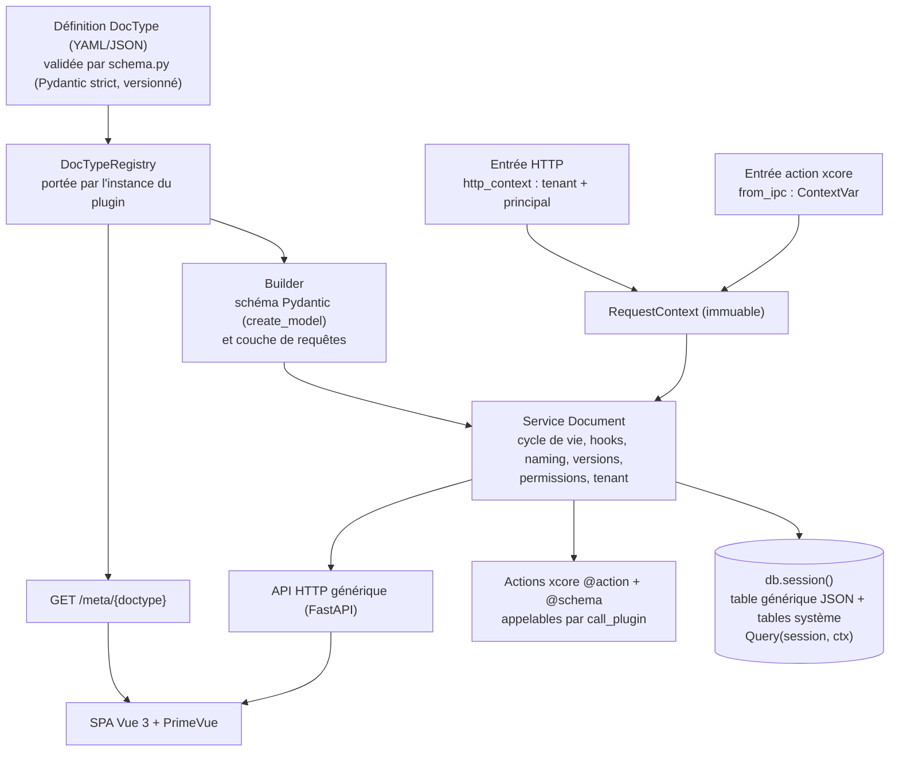

# xcore-doctype : documentation de conception complète

Version 3, 17 octobre 2026. Remplace la version consolidée v1 + v2.

Plugin installable pour xcore apportant un moteur de DocTypes et un Desk (UI) inspirés de Frappe, sans dépendre de Frappe. Cette version intègre la revue d'intégration xcore : elle est vérifiée contre le code d'xcore (`main`, commit 7c95dff, version 2.9.1) et reste recadrée sur un objectif de **20 % de Frappe**. En cas de contradiction avec les versions précédentes, la v3 prévaut.

## 1. En bref

`xcore-doctype` est un plugin xcore Trusted qui apporte un moteur de DocTypes (une définition déclarative dont dérivent stockage, API, permissions, hooks et interface) et une UI Vue 3 + PrimeVue. On ne réutilise ni Frappe ni sa Desk.

Acquis des versions précédentes :

1. **Les hooks de validation ne passent pas par l'EventBus.** `EventBus.emit` avale les erreurs des handlers : `validate` et `before_save` sont appelés directement par le service `Document`, seuls les `after_*` sont publiés.
2. **L'isolation tenant ne repose pas sur `TenantAwareDB`**, qui n'isole que sur PostgreSQL. Toutes les tables portent `tenant_id`, filtré dans une couche de requêtes unique, testée sur SQLite et PostgreSQL.
3. **Les plugins sandboxés ne peuvent pas appeler xcore-doctype** (`call_plugin` leur est indisponible). Leurs contrôleurs sont des actions que xcore-doctype appelle.
4. **Les permissions par ligne** (`if_owner`, `match`) entrent dans le schéma dès la v1 du moteur.
5. **Pas de SQLModel** : SQLAlchemy 2.x pour les tables système, Pydantic `create_model` pour les schémas dynamiques.
6. **Interface** : on récupère l'UX et les idées de la Desk de Frappe, pas son code (section 12).

Nouveautés de la v3 (revue d'intégration) :

7. **Contexte de requête explicite.** Le service `Document` ne lit jamais d'état ambiant : chaque entrée (HTTP ou action xcore) construit un `RequestContext` immuable (section 14 bis et annexe A).
8. **Tenant lié à l'identité.** Le header `X-Tenant-ID` n'est pas authentifié par xcore : le tenant doit être couvert par un claim du principal (D17).
9. **Contrat d'intégration xcore** : signature `strict_trusted`, bloc `permissions` du manifeste, `allowed_callers`, shim d'entry point, type de base asynchrone (section 14 bis, D18 à D20).
10. **Hooks sandboxés exécutés avant la transaction d'écriture** (D4 précisé, D21).
11. **Concurrence optimiste par colonne `version`** et non par horodatage (D15 corrigé).
12. **Phase 0 élargie** d'un spike d'intégration xcore, avec critères d'acceptation (section 14 bis.8).

## 2. Contexte, décision et licences

**xcore** est un orchestrateur plugin-first construit sur FastAPI (noyau minimal, plugins sandboxés, EventBus, conteneur de services, multi-tenancy). **Frappe** est un framework full-stack « batteries included » (DocTypes, ORM maison, permissions, workflows, Desk, jobs Redis, système d'apps via bench), à la base d'ERPNext.

**Décision : ne pas fusionner les deux.** On reprend le principe central de Frappe (un DocType déclaratif dont tout dérive) dans un package `xcore-doctype`.

Les raisons qui tiennent après vérification :

- **Conflit d'épingles de dépendances** : Frappe v16 exige `pydantic~=2.12.5`, xcore `>=2.13.5`.
- **Chevauchement** : les deux ont déjà un système de plugins/apps, de permissions, de tâches planifiées et de multi-tenancy (sites chez Frappe, tenants chez xcore). Il y aurait des doublons à arbitrer.
- **Maintenance** : Frappe évolue vite et change souvent ses internals ; un fork fusionné serait coûteux à maintenir.
- **Licences** : ERPNext et `bench` sont sous GPL-3.0. Avant de reprendre du code d'un dépôt Frappe, lire son fichier `LICENSE` ; le framework et `frappe-ui` ont une licence distincte à vérifier.
- **Couplage de la Desk** à son backend (`frappe.boot`, sessions, endpoints `/api/method/...`).

La raison « WSGI contre ASGI » de la v1 est devenue faible : la branche `develop` de Frappe a une entrée ASGI (`frappe.asgi`).

## 3. Objectifs et non-objectifs

**Objectifs**

- Définir un DocType une seule fois (JSON/YAML validé par Pydantic) et en dériver : stockage, API CRUD, permissions, hooks, UI.
- Être installable par `pip install xcore-doctype` et chargé comme plugin xcore.
- Fonctionner avec SQLite en développement et PostgreSQL en production.
- Permettre à d'autres plugins xcore (modules métier) de déclarer leurs propres DocTypes.

**Non-objectifs (au départ)**

- Compatibilité avec le protocole ou la Desk de Frappe.
- Éditeur de DocType dans l'UI, workflows, rapports avancés, impression PDF.
- Comptabilité complète (écritures, stock valorisé) : chantier distinct, à traiter après validation du moteur.

## 4. Périmètre : le 20 % de Frappe

Ce tableau est le contrat de périmètre : tout ajout passe par une phase de la feuille de route.

| Fonctionnalité | Décision | Phase | Pourquoi |
| --- | --- | --- | --- |
| DocType déclaratif (la définition engendre tout) | Garder | 0 | Principe central |
| Champs Text, Number, Date, Boolean, Select, Link | Garder | 0 à 3 | MVP ; Link complet en phase 3 |
| Tables enfants (champ `Table`) | Garder, stockées en tableau JSON dans le document parent | 3 | Indispensable aux documents à lignes (factures) ; atomique et simple |
| Datetime, Currency, Attach, Text Editor | Plus tard | 3 et après | Non bloquants |
| CRUD générique et `/meta` | Garder | 0 | Cœur du moteur |
| Permissions rôle × action | Garder | 1 | Base de la sécurité |
| Restrictions par ligne (`if_owner`, `match`) | Garder, forme simplifiée | 1 | Sans elles, pas de cloisonnement par société ou territoire |
| Permissions par champ (niveaux) | Plus tard | après 4 | Prévu dans le schéma, non implémenté |
| Hooks `validate`, `before_save`, `after_save` | Garder | 1 | Règles métier |
| Expressions `depends_on` (affichage, obligation, lecture seule) | Garder, grammaire restreinte (D22) | 2 | Forte valeur UX, évaluées côté client et revérifiées côté serveur |
| Numérotation (naming series) | Garder | 3 | Identifiants lisibles |
| Historique (Version) | Garder | 3 | Traçabilité |
| ListView et FormView | Garder | 2 | Interface de base |
| Submit, Cancel, Amend (documents soumettables) | Plus tard | après 4 | Lié à la comptabilité |
| Workflows | Hors périmètre | — | Trop large |
| Rapports, impression PDF, import/export | Hors périmètre | — | Trop large |
| Éditeur de DocType dans l'UI | Hors périmètre | — | Les définitions restent des fichiers |
| Personnalisation par site (champs custom) | Hors périmètre | — | Complexifie schéma et migrations |
| Portail web, traduction complète | Hors périmètre | — | Libellés seulement |
| Comptabilité, stock valorisé | Chantier distinct | — | À traiter après validation du moteur |

## 5. Architecture



Principe directeur : toute fonctionnalité passe par la définition, jamais par du code spécial pour un DocType donné. Le service `Document` est la seule porte vers les données ; les routes HTTP et les actions xcore en sont de fines enveloppes qui construisent un `RequestContext`.

## 6. Ce que dit le code d'xcore (faits vérifiés)

| Hypothèse | Ce que dit le code | Décision |
| --- | --- | --- |
| `pip install` suffit à charger le plugin | Découverte par scan de dossier (`loader.py` : `plugin_dir.iterdir()` et `plugin.yaml`), aucun entry point | D1 : groupe d'entry points `xcore.plugins` à ajouter à xcore |
| Le wheel peut être chargé comme n'importe quel plugin Trusted | `strict_trusted` vaut `True` par défaut (`_parse_plugins`) ; `TrustedActivator` exige `plugin.sig` signé avec la clé du déploiement | D19 : liste blanche d'entry points de confiance |
| Les actions du plugin sont appelables | `PermissionMiddleware` vérifie `check(<plugin cible>, <action>, "execute")` ; sans `permissions` dans le manifeste, `deny_all` | D18 : bloc `permissions` et `allowed_callers` dans le manifeste embarqué |
| Hooks sur l'EventBus | `emit` isole les erreurs (log + compteur), `cancelled` n'arrête que les handlers suivants | D2 : appel direct pour `validate` et `before_save` |
| Multi-tenancy native avec SQLite en dev | `TenantAwareDB` isole par `search_path` PostgreSQL, ignoré ailleurs ; il ajoute 2 requêtes par transaction et refuse `AUTOCOMMIT` | D3 : colonne `tenant_id` portable, `isolate_db: false` recommandé |
| Le tenant fait foi | `TenantMiddleware` lit `X-Tenant-ID` sans authentification | D17 : tenant lié à un claim du principal |
| `get_current_principal()` fonctionne partout | `_current_principal` et `_current_tenant_id` ne sont posées que dans `Supervisor._dispatch` ; les routes HTTP du plugin passent par FastAPI sans pipeline | D20 : `RequestContext` explicite |
| Plugin sandboxé accède aux données par API | `call_plugin()` indisponible en sandbox (`ctx.caller` vaut `None`) | D4 : contrôleurs sandboxés = actions appelées |
| Hooks sandboxés sans coût | Canal IPC sérialisé par verrou ; le worker saute les lignes de plus de 64 KiB sans répondre ; rate limit sandbox 100/60 s | D21 : hooks externes avant la transaction, taille bornée |
| SPA servie par `StaticFiles` | Fonctionne au montage (testé via `Xcore._mount_plugin_router`, 200), routes sous `<plugin_prefix>/<plugin>` (défaut `/plugin`) ; démontage et reload à revérifier | D9 : URL de base configurable |
| Base asynchrone par défaut | `_TYPE_MAP` associe `sqlite` à l'adaptateur **synchrone** ; l'async demande `sqlite+aio` | D11 : vérification au `on_load` |
| Alembic programmatique | `MigrationRunner` suppose un dossier alembic statique (`alembic init`) | D10 : opérations générées à l'exécution |
| SQLModel pour les tables système | sqlmodel 0.0.48 exige `SQLAlchemy<2.2` (xcore : 2.1.x, compatible aujourd'hui) | D11 : pas de SQLModel |
| Rôles « existants ou à créer » | xcore ne stocke ni utilisateurs ni rôles : seulement `AuthBackend` et `AuthPayload` (`sub`, `roles`, `permissions`, `user`) | D12 : plugin d'auth séparé |
| Le rechargement recharge tout le plugin | `LifecycleManager` ne purge que `xcore_plugin_<nom>.*` ; le code d'un package installé n'est pas rechargé | D1/D8 : shim `main.py`, état porté par l'instance |

## 7. Modèle de données

### 7.1 Choix de la couche de persistance

- **Persistance : SQLAlchemy 2.x. Validation et schémas d'API : Pydantic v2.**
- **Tables système** (`DocType`, `DocField`, `DocPerm`, `Document`, `Version`, `NamingSeries`) : SQLAlchemy déclaratif. SQLModel est écarté (D11) à cause de sa contrainte de version sur SQLAlchemy.
- **Tables dynamiques** (générées depuis un DocType) : SQLAlchemy pur, construites à l'exécution ; le schéma Pydantic est généré avec `pydantic.create_model`, en `extra="forbid"`.
- **Deux objets `MetaData` séparés** (système et dynamique) pour éviter les collisions et permettre de recharger un DocType sans toucher au reste.

### 7.2 Stratégie de stockage hybride

| Stratégie | Avantages | Inconvénients |
| --- | --- | --- |
| Table générique `Document` avec colonne JSON | Pas de migration pour ajouter un champ, démarrage rapide | Filtres et rapports moins efficaces ; pas de clés étrangères |
| Une table réelle par DocType | Requêtes et index performants | Migration de schéma à chaque changement de champ |

**Recommandation :** démarrer avec la table générique pour valider le moteur, puis promouvoir en tables dédiées les DocTypes volumineux ou critiques (factures, écritures). Le seuil de promotion n'est pas fixé : il se décide sur mesure, avec un benchmark sur les deux bases.

Colonnes de la table générique : `name`, `doctype`, `tenant_id`, `data` (JSON), `owner`, `creation`, `modified`, `version` (entier, D15). Clé primaire et unicité sur `(tenant_id, doctype, name)` ; index `(tenant_id, doctype, modified)`.

**Intégrité sans clés étrangères.** Le moteur contrôle à l'écriture que la cible d'un champ Link existe et est lisible par l'utilisateur, et à la suppression qu'aucun document ne la référence encore.

**Évolution des définitions.** Validation stricte à l'écriture, tolérante à la lecture (un ancien document qui ne respecte plus la définition ne fait pas échouer une liste). Les champs ajoutés comme obligatoires ne sont exigés qu'à la prochaine sauvegarde. Les changements de type et les renommages passent par une opération explicite versionnée (`rename`, `retype`).

### 7.3 Portabilité SQLite / PostgreSQL

```python
from sqlalchemy import JSON
from sqlalchemy.dialects.postgresql import JSONB

JsonType = JSON().with_variant(JSONB, "postgresql")
```

- Isoler tout opérateur spécifique à un dialecte dans la couche de requêtes (`query.py`).
- Index JSON : GIN sur PostgreSQL, index sur expressions sur SQLite.
- Alembic avec `render_as_batch=True` pour SQLite (`ALTER TABLE` limité).
- Accès asynchrone uniquement (`aiosqlite` en développement) ; au `on_load`, le plugin vérifie le type de l'adaptateur (D11).
- SQLite : mode WAL et `busy_timeout`, posés une fois au `on_load`.
- La CI exécute les tests sur **les deux bases** dès le début, avec des tests de parité pour les filtres et tris sur le JSON.

## 8. Décisions de conception

D1 à D12 sont retenues (certaines précisées en v3). D13 à D16 sont des propositions à valider. D17 à D22 sont nouvelles en v3.

- **D1, livraison.** Plugin Trusted (il a besoin de la base, d'un routeur et de fichiers statiques), enregistré par entry point `xcore.plugins`. Le wheel embarque un dossier plugin complet (`plugin.yaml` + `src/main.py`) ; `main.py` est un shim qui expose `Plugin` et délègue à `xcore_doctype`. Le scan de dossier reste le repli (section 14 bis.1).
- **D2, cycle de vie.** Le service `Document` appelle `validate` et `before_save` directement et lève `DocumentValidationError` pour annuler. Les `after_*` sont publiés sur l'EventBus **après la sortie du bloc `async with session()`** (donc après le commit) : ce sont des notifications qui ne peuvent rien annuler.
- **D3, tenant.** Chaque table, générique ou dédiée, porte `tenant_id`. La couche de requêtes l'injecte dans toute lecture et toute écriture ; aucune requête ne se construit hors de cette couche. Sur PostgreSQL, le `search_path` d'xcore retombe sur `public` quand le schéma du tenant n'existe pas, et nos tables y vivent. Ne jamais utiliser `.engine` ni `__getattr__` de `TenantAwareDB` pour écrire, qui exposent la base non isolée (le dialecte se lit via `db.engine.dialect.name`, en lecture seule). Recommander `tenancy.isolate_db: false` pour ce plugin.
- **D4, plugins sandboxés.** Ils ne peuvent pas appeler xcore-doctype. Un contrôleur sandboxé est une action : xcore-doctype l'appelle via `call_plugin` avec le document en charge utile et reçoit le document modifié ou une erreur. Le plugin sandboxé ne touche jamais la base. Déclaration : `before_save: ["action:sales_rules.check_credit"]`. Il doit lister `xcore-doctype` dans ses `allowed_callers`.
- **D5, stockage.** Table générique unique avec `JSON().with_variant(JSONB, "postgresql")` (voir 7.2 et 7.3).
- **D6, permissions.** Un utilisateur accède à un document si l'une des lignes de permission de ses rôles l'autorise. Une ligne avec `if_owner` ne vaut que pour les documents que l'utilisateur a créés. Une ligne avec `match` ne vaut que si `doc[field] == principal["user"][principal_attr]`. En lecture de liste, ces conditions deviennent des filtres SQL, jamais un filtrage après coup. À l'écriture, `match` est aussi vérifié sur la **valeur écrite** (on ne crée ni ne déplace un document hors de son périmètre). La recherche Link applique les mêmes permissions.
- **D7, numérotation.** Table `naming_series(tenant_id, prefix, current)` ; création du compteur par `INSERT … ON CONFLICT DO UPDATE … RETURNING`, incrément par `UPDATE … RETURNING`. Vérifié sur SQLite 3.53 : 25 appels concurrents, 25 valeurs distinctes (preuve limitée : SQLite sérialise déjà les écritures). À vérifier sur PostgreSQL. Choix ouvert : même transaction que le document (sans trou, mais sérialise les créations d'un même préfixe) ou transaction séparée (trous acceptés, pas de contention). Par défaut : transaction séparée, sauf exigence légale de séquence continue.
- **D8, rechargement.** xcore purge `sys.modules` du plugin au reload, mais seulement l'espace `xcore_plugin_<nom>.*` (le shim) ; le code de `xcore_doctype` n'est pas rechargé. Le registre et les `MetaData` sont créés dans `on_load` et rendus dans `on_unload` ; aucun état au niveau du module. Les tâches de fond passent par `ctx.spawn_task`.
- **D9, API et UI.** Routes sous `<plugin_prefix>/xcore-doctype/` (`app.plugin_prefix`, défaut `/plugin` : lire la valeur, ne pas la coder). La SPA lit son URL de base depuis `/meta`. Le build est embarqué dans le wheel et servi par `StaticFiles` monté dans le routeur du plugin, avec un fallback SPA (mode history). Montage, démontage et reload sont à vérifier.
- **D10, migrations.** Pas de migration pour la table générique. Pour une table dédiée, les opérations sont produites à l'exécution à partir de la différence entre deux versions de définition (`schema_version`), avec `render_as_batch` sur SQLite.
- **D11, accès base.** Asynchrone uniquement, par `db.session()` (éventuellement enveloppé par `TenantAwareDB`). Au `on_load`, vérifier que `db` est un `AsyncSQLAdapter` ; sinon échouer avec un message clair (le type `sqlite` est synchrone, il faut `sqlite+aio` avec une URL `aiosqlite`). Pas de SQLModel.
- **D12, authentification.** Aucune table d'utilisateurs ici. Les rôles viennent du principal : `get_current_user` en HTTP, `get_current_principal()` en action, tous deux normalisés par `RequestContext`. Un backend d'auth de test est fourni pour le développement ; le vrai login est un plugin d'auth séparé.
- **D13, compteur par tenant (proposition).** `naming_series` porte `tenant_id`, avec unicité `(tenant_id, prefix)`. Sinon deux tenants partagent un compteur, ce qui est à la fois une fuite d'information et un bug. Idem pour les clés des documents : unicité sur `(tenant_id, doctype, name)`.
- **D14, défense en profondeur (proposition).** Sur PostgreSQL, activer la Row Level Security en production en complément de la couche de requêtes. Conditions : `FORCE ROW LEVEL SECURITY` et un rôle applicatif distinct du propriétaire de la table ; valeur du tenant posée par `set_config` à chaque transaction, depuis le `RequestContext`, jamais depuis le header. Le test de fuite en CI reste obligatoire.
- **D15, concurrence optimiste (corrigée).** Colonne `version` entière, incrémentée à chaque écriture. La sauvegarde est un `UPDATE … WHERE tenant_id=? AND doctype=? AND name=? AND version=?` dont on contrôle `rowcount` ; zéro ligne touchée donne un conflit (409). Un horodatage `modified` ne suffit pas (collisions de précision, décalage d'horloge) et un contrôle en Python n'est pas atomique.
- **D16, registre de hooks (proposition).** Les hooks en chemin pointé (`sales.hooks.check_credit`) ne sont pas importés dynamiquement depuis n'importe quel chemin d'un fichier YAML : un plugin déclare explicitement ses hooks dans un registre, et la définition y fait référence par nom.
- **D17, tenant lié à l'identité (nouveau).** `TenantMiddleware` lit `X-Tenant-ID` sans authentification. Quand `tenancy.enabled` est vrai, le principal doit porter un claim de tenant (`tenant_claim`, cherché dans le principal puis dans `principal["user"]`). Claim absent avec `require_tenant_claim` : refus. Claim différent du header : refus, sauf permission `cross_tenant_grant`. Si la tenancy est désactivée, le tenant est `default`.
- **D18, manifeste embarqué (nouveau).** Le manifeste déclare `permissions` (`doc.*` et `meta.*` en `execute`, sans quoi `PermissionEngine` refuse tout), `allowed_callers: ["*"]` (l'autorisation réelle est faite par le service `Document`) et un `timeout_seconds` relevé. Le rate limit du plugin est global à tous les tenants : à dimensionner large, il ne remplace pas un quota par tenant (annexe B).
- **D19, confiance de l'entry point (nouveau).** Un plugin issu d'un entry point est de confiance par installation, via une liste blanche en configuration (`plugins.trusted_entry_points`). `pip install` donne déjà l'exécution de code ; la signature ne peut pas être fournie par un wheel. Repli pour les déploiements qui exigent la signature : une commande `sign` qui copie le dossier plugin hors de `site-packages`.
- **D20, contexte explicite (nouveau).** Le service `Document` reçoit un `RequestContext` immuable (tenant, principal, source) en premier argument de toute opération. Il ne lit jamais les `ContextVar` lui-même. Sans utilisateur identifié, l'opération est refusée ; les jobs et appels service à service utilisent `RequestContext.system(tenant, reason)`, explicite et journalisé. `tenant_id`, `owner` et `user` ne viennent jamais du payload (annexe A).
- **D21, hooks sandboxés (nouveau).** Les hooks `action:` s'exécutent avant d'ouvrir la transaction d'écriture : pas de connexion ni de verrou tenus pendant un appel IPC (D15 couvre la course). Un document sérialisé de plus de 64 KiB est refusé en amont (`hook_payload_too_large`). Un hook en échec donne 422, un hook en timeout `hook_timeout`.
- **D22, expressions `depends_on` (nouveau).** Jamais d'`eval`. Grammaire restreinte (comparaisons, `and`/`or`/`not`, appartenance, littéraux), parsée en AST à liste blanche, partagée entre client et serveur. Alternative si la parité coûte trop : un format JSON structuré.

## 9. Définition d'un DocType

Le schéma (`schema.py`, Pydantic strict, versionné par `schema_version`) est le contrat de tout le reste. Les noms de champs reprennent ceux de Frappe (`fieldname`, `fieldtype`, `options`, `depends_on`) pour rester familiers à qui connaît Frappe, sans aucun couplage.

```yaml
schema_version: 1
name: Customer
label: Client
module: sales
naming: "CUST-.####"
fields:
  - { fieldname: customer_name, label: Nom, fieldtype: Text, required: true }
  - { fieldname: type, label: Type, fieldtype: Select, options: [Particulier, Entreprise] }
  - { fieldname: company_id, label: N° entreprise, fieldtype: Text, depends_on: "type == 'Entreprise'" }
  - { fieldname: credit_limit, label: Plafond, fieldtype: Number, default: 0 }
  - { fieldname: country, label: Pays, fieldtype: Link, options: Country }
permissions:
  - { role: Sales Manager, read: true, write: true, create: true, delete: true }
  - { role: Sales User, read: true, write: true, create: true, delete: false, if_owner: true }
  - { role: Regional Rep, read: true, match: { field: country, principal_attr: country } }
layout:
  - section: Général
    columns: [[customer_name, type], [credit_limit, country]]
hooks:
  validate: [sales.hooks.check_credit]
  before_save: ["action:sales_rules.check_credit"]
  after_save: [sales.hooks.notify_account_manager]
```

**Types du MVP :** Text, Number, Date, Boolean, Select, Link. Ensuite : Table, Datetime, Currency, Attach, Text Editor. Les expressions `depends_on` suivent la grammaire de D22 : évaluées côté client pour l'affichage, revérifiées côté serveur pour la validation. Les champs système (`name`, `owner`, `creation`, `modified`, `version`, `tenant_id`) sont réservés et rejetés dans un payload client.

| fieldtype | Composant PrimeVue |
| --- | --- |
| Text | InputText |
| Number | InputNumber |
| Date | DatePicker |
| Boolean | Checkbox |
| Select | Select |
| Link | AutoComplete (recherche sur le DocType lié, filtrée par les permissions) |

## 10. API

| Méthode | Route | Rôle |
| --- | --- | --- |
| GET | `/meta` | DocTypes accessibles à l'utilisateur (barre latérale) |
| GET | `/meta/{doctype}` | Champs, layout et droits effectifs |
| GET | `/list/{doctype}` | Liste filtrée, triée, paginée côté serveur |
| GET | `/doc/{doctype}/{name}` | Lecture |
| POST | `/doc/{doctype}` | Création |
| PUT | `/doc/{doctype}/{name}` | Mise à jour (conflit 409 si `version` périmée) |
| DELETE | `/doc/{doctype}/{name}` | Suppression (refusée si le document est référencé) |

Les mêmes opérations existent comme actions xcore (`doc.get`, `doc.list`, `doc.save`, `doc.delete`, `meta.get`), avec `@schema` dérivé de la définition. Les droits sont vérifiés par le service `Document`, pas par `@action(permissions=...)`, qui ne connaît que des chaînes statiques.

**Toutes** les routes HTTP, `/meta` compris, dépendent de `http_context` ; seuls les fichiers statiques de la SPA sont publics. Les routes du plugin contournent le pipeline xcore (rate limit, audit IPC, tracing) : si un quota ou un audit est requis en HTTP, il est implémenté dans le service `Document`.

## 11. Cycle de vie, permissions et multi-tenancy

**Cycle de vie.** Ordre d'une sauvegarde :

1. Construction du `RequestContext` et contrôle d'identité (D17, D20).
2. Lecture du document courant, hooks `action:` sandboxés (D21).
3. Ouverture de la transaction ; `validate` et `before_save` Trusted ; contrôle des Link ; écriture avec contrôle de `version` (D15) ; entrée `Version` (différence seulement).
4. Commit, puis sortie du bloc de session.
5. `after_save`, puis événement sur l'EventBus.

Une erreur avant le commit annule tout (422, ou 409 en cas de conflit de version) ; une erreur dans un `after_*` est journalisée et ne défait rien. Les documents soumettables (`submit → cancel`) viennent plus tard.

**Permissions.** Par rôle et par action (lecture, écriture, création, suppression), avec restrictions par ligne (D6). Les permissions par champ sont prévues dans le schéma mais non implémentées. Sans principal, tout est refusé.

**Multi-tenancy.** `tenant_id` sur toutes les tables, injecté par `Query(session, ctx)` (D3), avec unicités composites (D13), tenant lié à l'identité (D17) et RLS en production (D14).

**Plugins sandboxés.** Ils accèdent aux données uniquement par des actions contrôlées, jamais directement à la base (D4, D21).

## 12. Interface : récupérer la Desk sans la cloner

On ne clone pas le code de la Desk : c'est une application jQuery qui suppose tout l'environnement Frappe (`frappe.boot`, `frappe.call`, `frappe.model`, socket.io, format exact des métadonnées). La porter vers Vue n'apporterait rien, puisque PrimeVue fournit déjà les composants. On s'en sert comme référence d'UX et de comportement, en réécrivant.

**Stack :** Vue 3, PrimeVue, Vite. Le build est embarqué dans le package et servi par FastAPI (`StaticFiles`) ; en développement, Vite tourne avec un proxy vers l'API.

**Vues génériques pilotées par `/meta` :**

- `ListView` : `DataTable` avec filtres, tri et pagination côté serveur.
- `FormView` : sections et colonnes issues du layout, validation côté client, expressions `depends_on`, gestion du conflit 409 (proposer de recharger).
- Barre latérale générée depuis la liste des DocTypes accessibles.
- `FieldRenderer` : choisit le composant selon `fieldtype` (tableau de la section 9).
- Retours utilisateur : `Toast` et `ConfirmDialog`.

| À reprendre comme référence | Pourquoi |
| --- | --- |
| Contrôles de champs (`public/js/frappe/form/controls/`) | Comportements fins du Link (recherche, création rapide), des dates, des sélecteurs |
| Expressions `depends_on`, `mandatory_depends_on`, `read_only_depends_on` | Idée la plus rentable de Frappe ; ajoutée au schéma en phase 2 |
| Logique de layout (sections, colonnes, onglets, sections repliables) | Formulaires lisibles sans code par DocType |
| ListView (barre de filtres, tri, colonnes configurables, actions groupées) | Interface de liste complète |
| Noms des métadonnées (`fieldname`, `fieldtype`, `options`) | Familiarité, documentation existante, import de DocTypes Frappe plausible plus tard |

**Règle de licence :** avant de copier du code d'un dépôt Frappe, lire son `LICENSE` ; copier du code GPL dans un plugin distribué peut imposer la même licence. S'inspirer d'un comportement et le réécrire ne pose pas ce problème.

## 13. Structure du package

```
xcore-doctype/
├── pyproject.toml          # entry point xcore.plugins ; extras [postgres]
├── src/xcore_doctype/
│   ├── plugin.py           # classe Plugin(TrustedBase), appelée par le shim
│   ├── plugin_dir/         # dossier plugin embarqué : plugin.yaml + src/main.py (shim)
│   ├── context.py          # RequestContext, ContextSettings, http_context
│   ├── schema.py           # définition (Pydantic strict, versionnée)
│   ├── registry.py         # chargement, cache, rechargement
│   ├── builder.py          # définition -> schéma Pydantic + requêtes
│   ├── query.py            # couche de requêtes unique : Query(session, ctx)
│   ├── document.py         # cycle de vie, hooks, naming, versions
│   ├── permissions.py
│   ├── expr.py             # grammaire depends_on (AST en liste blanche)
│   ├── api/                # routeur générique, /meta, actions xcore
│   ├── db/                 # JsonType, tables système, migrations à l'exécution
│   └── ui/dist/            # build PrimeVue embarqué dans le wheel
├── ui/                     # sources Vue 3 + PrimeVue (Vite)
└── tests/                  # exécutés sur SQLite ET PostgreSQL
```

**Installation :** `pip install xcore-doctype` (extras possibles : `[postgres]`), puis déclaration du plugin dans la liste blanche (D19). Les DocTypes des autres plugins sont déposés dans un dossier convenu (proposition : `<dossier du plugin>/doctypes/*.yaml`) et lus par le registre au démarrage.

## 14. Prérequis côté xcore (issues à ouvrir)

1. **Entry points de plugins** : abstraction `PluginSource` (dossier local, groupe `xcore.plugins`) dans `kernel/runtime/loader.py` ; un dossier local de même nom l'emporte, avec avertissement ; le flag `enabled` de `PluginStateStore` s'applique aussi aux entry points.
2. **Confiance des entry points** : option `plugins.trusted_entry_points` qui exempte de `verify_plugin` les entry points listés, et commande `sign` en repli (D19).
3. **API publique du contexte de tenant** : exposer `_validate_tenant` et `_current_tenant_id` dans `xcore.kernel.tenancy` plutôt que de les importer depuis un module privé.
4. **Avertissement tenancy** : au boot, signaler quand `tenancy.enabled` est vrai avec un adaptateur non PostgreSQL (aujourd'hui l'isolation est ignorée avec un simple log de niveau debug).
5. **Liaison tenant / identité** : documenter que `X-Tenant-ID` n'est pas authentifié, et proposer un hook optionnel de vérification dans `TenantMiddleware`.
6. **Documentation** : préciser que `EventBus.emit` n'annule rien, que `call_plugin` est absent en sandbox, que les routes d'un plugin contournent le pipeline, et que `permissions` absent signifie `deny_all`.
7. **Worker sandbox** : répondre par une erreur (au lieu de continuer sans réponse) quand une ligne IPC dépasse la limite du `StreamReader`.

## 14 bis. Intégration xcore (contrat d'intégration)

Cette section décrit ce que `xcore-doctype` doit respecter pour être chargé et appelé correctement par xcore. Elle se valide par le spike de la phase 0 (14 bis.8).

### 14 bis.1 Chargement par entry point

- **Constat.** `PluginLoader` ne connaît que le scan de dossier : `load_all()` et `discover_names()` utilisent `iterdir()`, `load()` suppose `<directory>/<nom>`. `LifecycleManager` importe `plugin_dir/entry_point` sous `xcore_plugin_<nom>.main`.
- **Contrat.** Le wheel embarque un dossier plugin complet (`plugin.yaml` + `src/main.py`). Ce `main.py` est un shim qui expose `Plugin` et délègue à `xcore_doctype`. Seul le shim est purgé de `sys.modules` au reload, pas le moteur : à documenter.
- **Changement xcore.** Abstraction `PluginSource` (dossier local, entry point du groupe `xcore.plugins`). Un entry point renvoie le chemin du dossier plugin, résolu via `importlib.resources`. `load_all`, `load`, `reload` et `discover_names` passent par elle.

### 14 bis.2 Signature (`strict_trusted`)

`strict_trusted` vaut `True` par défaut ; `plugin.sig` est calculé avec la clé du déploiement, et `site-packages` peut être en lecture seule. Un wheel ne peut donc pas fournir la signature. Décision D19 : liste blanche en configuration, signature en repli.

### 14 bis.3 Manifeste embarqué

Voir l'annexe B. Rappels : sans `permissions`, tout appel est refusé ; `allowed_callers` est deny-by-default quand `tenancy.enforce_ipc` est actif ; le rate limit est global au plugin ; le bloc `doctype:` tombe dans `manifest.extra`, lu via `ctx.config`.

### 14 bis.4 Deux chemins d'entrée, un seul contexte

| | HTTP (routeur du plugin) | Action xcore (`call_plugin`, `/ipc/...`) |
| --- | --- | --- |
| Pipeline (rate limit, audit, permissions) | **Contourné** | Appliqué |
| Tenant | `request.state.tenant_id` | `ContextVar _current_tenant_id` (posée seulement si `tenancy.enabled`) |
| Utilisateur | `Depends(get_current_user)` | `get_current_principal()` |

Règle (D20) : le service `Document` ne lit jamais d'état ambiant ; chaque entrée construit un `RequestContext` (annexe A).

### 14 bis.5 Tenant lié à l'identité

Voir D17. La valeur posée pour la RLS (D14) vient du `RequestContext`, jamais du header.

### 14 bis.6 Accès base

Voir D3 et D11. `session()` commite à la sortie du bloc : les `after_*` et événements sont émis après cette sortie.

### 14 bis.7 Hooks sandboxés

Voir D4 et D21. Le plugin sandboxé liste `xcore-doctype` dans ses `allowed_callers` ; le canal IPC est sérialisé par verrou ; le sandbox a son propre rate limit (100/60 s par défaut). Contrat de réponse : `{"status":"ok","doc":{...}}` ou `{"status":"error","code":...,"msg":...}`. Tenant et principal sont propagés par `call_plugin`.

### 14 bis.8 Critères d'acceptation du spike (phase 0)

1. `pip install` puis démarrage d'une instance neuve : le plugin se charge, `strict_trusted` actif, liste blanche configurée.
2. Un appel action `doc.get` aboutit ; sans le bloc `permissions`, il renvoie `permission_denied`.
3. Une route HTTP et une action donnent le même résultat pour le même utilisateur et le même tenant.
4. Header `X-Tenant-ID` différent du claim : 403 ; avec `cross_tenant_grant` : autorisé.
5. Appel sans principal : refus. Contexte système : autorisé et journalisé.
6. Un `validate` qui lève annule la sauvegarde ; un `after_save` qui lève ne défait rien.
7. Reload du plugin : routes remontées, aucun état résiduel (registre, `MetaData`).
8. Document de plus de 64 KiB vers un hook sandboxé : erreur immédiate, pas d'attente du timeout.
9. Test de fuite entre tenants, paramétré sur chaque fonction publique de `query.py`, sur SQLite et PostgreSQL.
10. Configuration avec adaptateur synchrone (`sqlite`) : échec clair au `on_load`.

## 15. Feuille de route

Les phases 0 à 4 représentent 13 à 16 semaines d'un développeur. Ces durées sont des estimations, à confirmer par la phase 0.

| Phase | Contenu | Durée | Critère de sortie |
| --- | --- | --- | --- |
| 0. Spike | `schema.py`, registre, document JSON, CRUD, `RequestContext`, couche de requêtes, test de fuite entre tenants, **spike d'intégration xcore** (14 bis) | 3 sem. | Critères 1 à 5, 7, 9 et 10 de 14 bis.8 ; un DocType défini en YAML se crée, se lit, se liste ; deux tenants ne se voient pas, sur SQLite et PostgreSQL |
| 1. Permissions et hooks | Rôles, `if_owner`, `match`, `validate` et `before_save`, actions sandboxées avant transaction, version optimiste | 2 à 3 sem. | Matrice de tests verte (rôle × action × `if_owner` × `match`) ; un `validate` annule ; critères 6 et 8 ; conflit 409 testé |
| 2. Interface | ListView, FormView, barre latérale, `depends_on` (grammaire D22), Toast et ConfirmDialog | 3 à 4 sem. | Le DocType Client se gère entièrement depuis l'UI |
| 3. Documents riches | Link complet (contrôle d'existence et de référence), tables enfants en tableau JSON, numérotation, versions | 3 à 4 sem. | Un DocType à lignes (facture sans comptabilité), numérotation sans doublon en concurrence sur les deux bases |
| 4. Livraison | CI SQLite + PostgreSQL, wheel avec l'UI, entry point, premier DocType réel, RLS PostgreSQL (D14) si validée | 2 sem. | `pip install xcore-doctype` puis le plugin se charge dans une instance xcore neuve |

Après la phase 4 : promotion en tables dédiées et migrations, documents soumettables, permissions par champ, rapports, premier module métier (Clients + Factures).

## 16. Risques

| Risque | Pourquoi | Parade |
| --- | --- | --- |
| Fuite entre tenants | Isolation xcore absente sur SQLite ; header `X-Tenant-ID` non authentifié | `tenant_id` partout, `Query(session, ctx)` unique, tenant lié au claim (D17), test de fuite en CI sur les deux bases, RLS en production (D14) |
| Contexte incohérent entre HTTP et action | Les `ContextVar` ne sont posées que par le pipeline ; les routes HTTP le contournent | `RequestContext` explicite, refus sans identité (D20) |
| Plugin non chargeable ou inappelable | `strict_trusted` par défaut, `deny_all` sans `permissions`, `allowed_callers` deny-by-default | Liste blanche d'entry points (D19), manifeste embarqué complet (D18), spike de phase 0 |
| Périmètre qui grossit | Longue traîne de Frappe (tables enfants, workflows, rapports, impression, traduction) | Tableau du §4 comme contrat ; tout ajout passe par une phase |
| Modèles dynamiques | Typage perdu, doublons au rechargement | État porté par l'instance du plugin (D8), schémas Pydantic générés, `extra="forbid"` |
| Définitions qui évoluent | Anciens documents invalides après un changement de type ou un champ requis ajouté | Lecture tolérante, écriture stricte, opérations `rename` et `retype` versionnées |
| Migrations de tables dédiées | Point le plus délicat | Reporté après la phase 4 ; définitions versionnées dès le départ |
| Permissions par ligne | Un filtrage après coup fuit des données ; recherche Link fuit des libellés | Conditions traduites en SQL (D6), `match` revérifié à l'écriture, Link filtré, tests dédiés |
| Écritures concurrentes | Deux utilisateurs peuvent s'écraser | Colonne `version` et `UPDATE` conditionnel (D15) |
| Numérotation | Course à la création du compteur ; contention si même transaction | `INSERT … ON CONFLICT`, choix explicite transaction séparée ou non (D7), test sur PostgreSQL |
| Filtres et tris JSON | Différences SQLite / PostgreSQL | Tout dans `query.py`, tests de parité sur les deux bases |
| Sandboxing | Un plugin sandboxé ne doit pas toucher la base ; IPC lent ou limité | Actions appelées par xcore-doctype uniquement (D4), hooks avant transaction et taille bornée (D21) |
| Expressions `depends_on` | Évaluation côté serveur d'une chaîne fournie par une définition | Grammaire restreinte, AST en liste blanche, jamais d'`eval` (D22) |
| Dépendance à un changement d'xcore | Entry points absents | Repli par scan de dossier ; changement petit et isolé (§14) |
| Pas d'authentification fournie | xcore n'a pas de table d'utilisateurs | Backend de test en développement, plugin d'auth séparé |
| Versions de dépendances | SQLAlchemy / Pydantic / aiosqlite | Vérifier la compatibilité avant de figer le `pyproject.toml` |

La comptabilité (écritures, stock valorisé) reste la partie réellement lourde d'un ERP, bien plus que le CRUD : à traiter comme un chantier distinct, après validation du moteur.

## 17. Décisions à valider et questions ouvertes

Valeurs par défaut retenues dans ce document :

1. **Tenant** : colonne `tenant_id` plutôt que schémas PostgreSQL par tenant, lié à un claim du principal.
2. **Base de données** : asynchrone uniquement.
3. **Permissions par ligne** : `if_owner` et `match` en v1 du moteur, rien de plus.
4. **Livraison** : entry point dans xcore plutôt qu'une copie dans le dossier des plugins.
5. **Confiance** : liste blanche d'entry points, signature en repli.
6. **Authentification** : plugin séparé, backend de test fourni.
7. **Tables enfants** : tableau JSON dans le document parent au départ.
8. **Isolation DB d'xcore** : `isolate_db: false` pour ce plugin.

À confirmer :

- **D13 à D16** (compteur par tenant, RLS, concurrence optimiste, registre de hooks) : propositions ; D15 est corrigée en colonne `version`.
- **Compteur de numérotation** : même transaction (sans trou) ou transaction séparée (trous acceptés) ; recommandation : transaction séparée.
- **Format de `depends_on`** : grammaire en chaîne ou JSON structuré (D22).
- **Exposition publique** de `_validate_tenant` et `_current_tenant_id` dans xcore.

Restent ouverts :

- L'emplacement exact des fichiers de DocTypes des plugins métier (proposition : `<dossier du plugin>/doctypes/*.yaml`).
- Le seuil de promotion d'un DocType de la table générique vers une table dédiée (à mesurer).
- Le mécanisme exact de `PluginSource` dans xcore (entry point à concevoir).

## 18. Ce qui n'a pas été vérifié

Le compteur de numérotation sur PostgreSQL, le comportement de `StaticFiles` au démontage et au reload d'un plugin (le montage est vérifié, le démontage s'appuie sur le même suivi de routes sans avoir été exécuté), PrimeVue et la SPA, le mécanisme d'entry point lui-même (à concevoir dans xcore), la RLS PostgreSQL (rôle applicatif, `FORCE ROW LEVEL SECURITY`, pooler), et le comportement de la limite de 64 KiB du worker sandbox avec la version de Python déployée.

## Annexe A. Gabarit `RequestContext`

```python
# xcore_doctype/context.py
from __future__ import annotations

from dataclasses import dataclass
from typing import Any, Callable, Literal, Mapping

from fastapi import Depends, HTTPException, Request
from xcore.kernel.api import get_current_user
from xcore.kernel.api.auth import get_current_principal
from xcore.kernel.tenancy import _current_tenant_id
from xcore.kernel.tenancy.services import _validate_tenant  # import privé : à exposer côté xcore

Source = Literal["http", "ipc", "system"]


class ContextError(Exception):
    def __init__(self, code: str, status: int = 403) -> None:
        super().__init__(code)
        self.code, self.status = code, status


@dataclass(frozen=True, slots=True)
class ContextSettings:
    enforce_tenant_binding: bool = True   # = tenancy.enabled
    tenant_claim: str = "tenant_id"
    require_tenant_claim: bool = True
    cross_tenant_grant: str = "doctype:cross_tenant"

    @classmethod
    def from_plugin_config(cls, config: dict, tenancy_enabled: bool) -> "ContextSettings":
        return cls(enforce_tenant_binding=tenancy_enabled, **config.get("doctype", {}))


@dataclass(frozen=True, slots=True)
class RequestContext:
    tenant_id: str
    principal: Mapping[str, Any] | None
    source: Source
    request_id: str | None = None
    reason: str | None = None  # renseigné uniquement pour source == "system"

    # ── Accesseurs ────────────────────────────────────────────
    @property
    def is_system(self) -> bool:
        return self.source == "system"

    @property
    def user_id(self) -> str | None:
        return (self.principal or {}).get("sub")

    @property
    def grants(self) -> frozenset[str]:
        p = self.principal or {}
        return frozenset(p.get("roles") or []) | frozenset(p.get("permissions") or [])

    def user_attr(self, name: str) -> Any:
        return ((self.principal or {}).get("user") or {}).get(name)

    def require_identity(self) -> None:
        if not self.is_system and self.user_id is None:
            raise ContextError("unauthenticated", 401)

    # ── Constructeurs ─────────────────────────────────────────
    @classmethod
    def system(cls, tenant_id: str, reason: str) -> "RequestContext":
        return cls(_validate_tenant(tenant_id), None, "system", reason=reason)

    @classmethod
    def from_ipc(cls, settings: ContextSettings) -> "RequestContext":
        """Appelé dans handle() d'une action : lit les ContextVar posées par _dispatch."""
        principal = get_current_principal()
        if principal is None:
            raise ContextError("unauthenticated", 401)
        tenant = _bind_tenant(_current_tenant_id.get(), principal, settings)
        return cls(tenant, principal, "ipc")

    @classmethod
    def from_http(
        cls, request: Request, principal: Mapping[str, Any], settings: ContextSettings
    ) -> "RequestContext":
        requested = getattr(request.state, "tenant_id", "default")
        tenant = _bind_tenant(requested, principal, settings)
        return cls(tenant, principal, "http", request.headers.get("x-request-id"))


def _bind_tenant(requested: str, principal: Mapping[str, Any], s: ContextSettings) -> str:
    """Le tenant du header n'est qu'une demande : il doit être couvert par l'identité."""
    tenant = _validate_tenant(requested)
    if not s.enforce_tenant_binding:
        return tenant
    claim = principal.get(s.tenant_claim) or (principal.get("user") or {}).get(s.tenant_claim)
    if claim is None:
        if s.require_tenant_claim:
            raise ContextError("tenant_claim_missing")
        return tenant
    if claim != tenant:
        grants = set(principal.get("roles") or []) | set(principal.get("permissions") or [])
        if s.cross_tenant_grant not in grants:
            raise ContextError("tenant_mismatch")
    return tenant


def http_context(settings: ContextSettings) -> Callable[..., RequestContext]:
    """Dépendance FastAPI à placer sur TOUT le routeur du plugin."""

    async def dep(request: Request, user=Depends(get_current_user)) -> RequestContext:
        try:
            ctx = RequestContext.from_http(request, user, settings)
            ctx.require_identity()
            return ctx
        except ContextError as e:
            raise HTTPException(status_code=e.status, detail=e.code) from e

    return dep
```

**Utilisation**

```python
# plugin.py (on_load)
settings = ContextSettings.from_plugin_config(self.ctx.config, tenancy_enabled)
router = APIRouter()  # pas de prefix : xcore ajoute <plugin_prefix>/xcore-doctype

@router.put("/doc/{doctype}/{name}")
async def put_doc(doctype: str, name: str, body: dict,
                  ctx: RequestContext = Depends(http_context(settings))):
    return await self.documents.save(ctx, doctype, name, body)

# action xcore
@action("doc.save")
async def doc_save(self, payload: dict) -> dict:
    try:
        ctx = RequestContext.from_ipc(self._settings)
    except ContextError as e:
        return error(e.code, "context_error")
    return await self.documents.save(ctx, payload["doctype"], payload["name"], payload["data"])
```

**Règles pour `query.py`**

- Le seul constructeur est `Query(session, ctx)`. Il injecte `tenant_id` et les filtres de permissions (D6) dans chaque requête.
- Aucune fonction ne prend un `tenant_id` brut en argument.
- Le test de fuite (critère 9) instancie `Query` avec deux contextes et vérifie l'étanchéité de chaque méthode publique.

## Annexe B. Manifeste embarqué

```yaml
name: xcore-doctype
version: 0.1.0
framework_version: ">=2.9"
execution_mode: trusted
entry_point: src/main.py
allowed_callers: ["*"]          # l'autorisation réelle est faite par le service Document
permissions:                    # sans ce bloc : deny_all (PermissionEngine)
  - { resource: "doc.*",  actions: ["execute"], effect: allow }
  - { resource: "meta.*", actions: ["execute"], effect: allow }
resources:
  timeout_seconds: 30           # défaut 10 : trop court pour de grosses listes
  rate_limit: { calls: 5000, period_seconds: 60 }   # global au plugin, tous tenants confondus
doctype:                        # lu via ctx.config["doctype"]
  tenant_claim: tenant_id
  require_tenant_claim: true
  cross_tenant_grant: "doctype:cross_tenant"
```

## Références

- Frappe, modèle de permissions : <https://docs.frappe.io/framework/user/en/basics/users-and-permissions>
- Frappe, dépendances de la v16 : <https://raw.githubusercontent.com/frappe/frappe/version-16/pyproject.toml>
- xcore : `xcore/kernel/events/bus.py`, `xcore/kernel/tenancy/services.py`, `xcore/kernel/tenancy/middleware.py`, `xcore/kernel/api/contract.py`, `xcore/kernel/api/auth.py`, `xcore/kernel/runtime/loader.py`, `xcore/kernel/runtime/activator.py`, `xcore/kernel/runtime/supervisor.py`, `xcore/kernel/middlewares/permissions.py`, `xcore/kernel/sandbox/worker.py`, `xcore/configurations/loader.py`, `xcore/services/database/manager.py`, `xcore/services/database/migrations.py`, `xcore/__init__.py` (`_mount_plugin_router`)
- Rapport d'analyse Frappe : `reports/xcore-frappe-integration.md`
- Revue d'intégration : `xcore-doctype-integration.md`