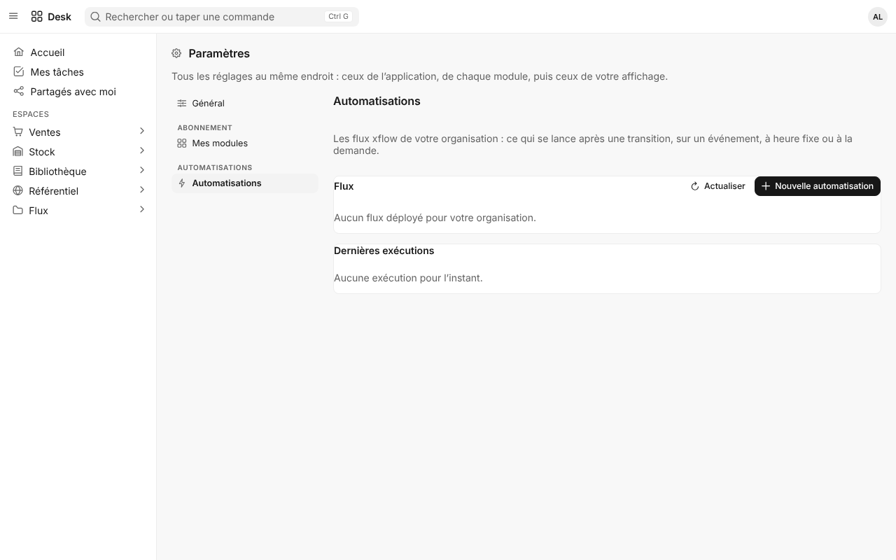
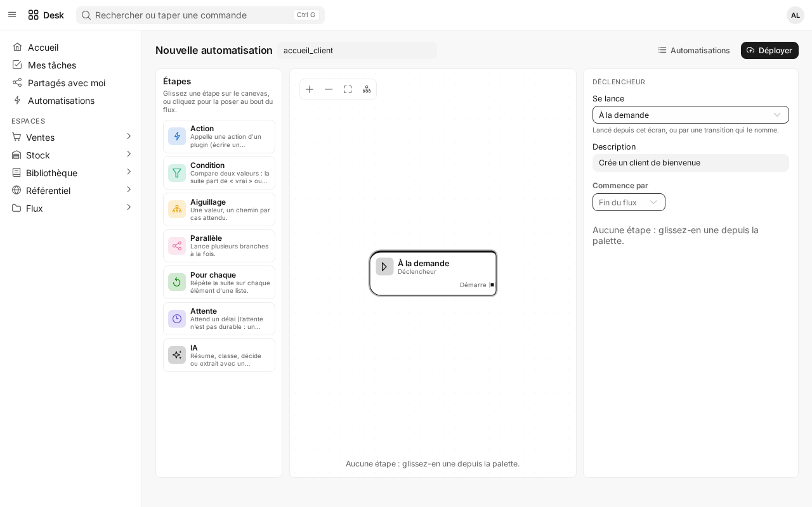
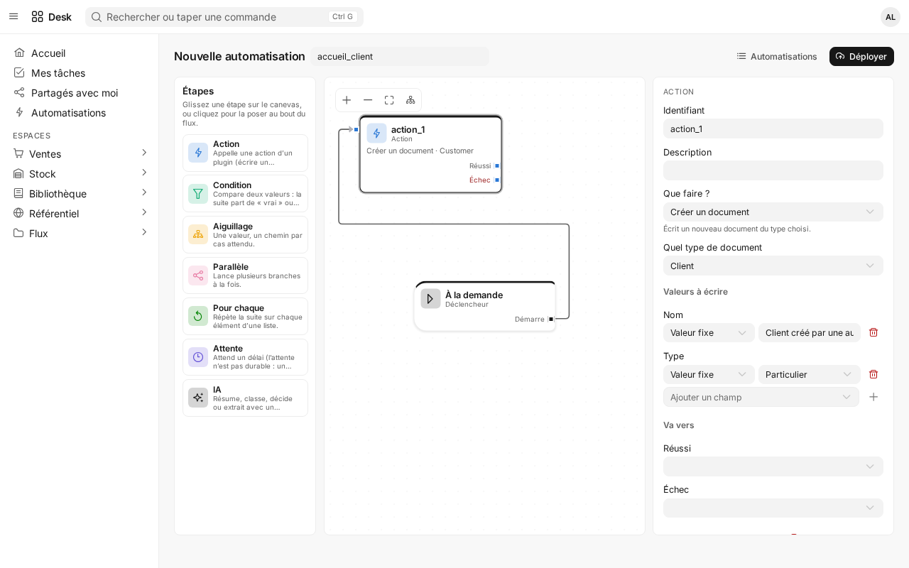
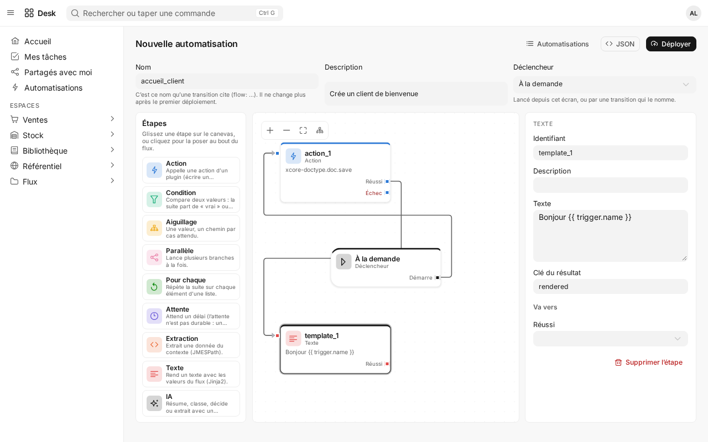
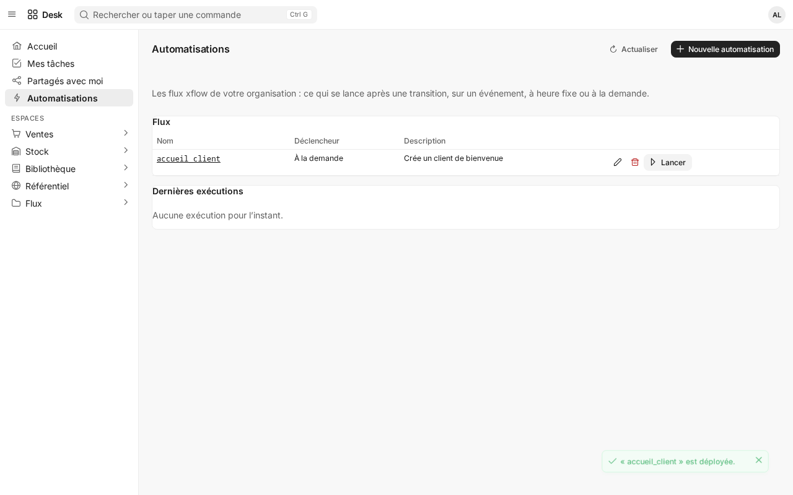
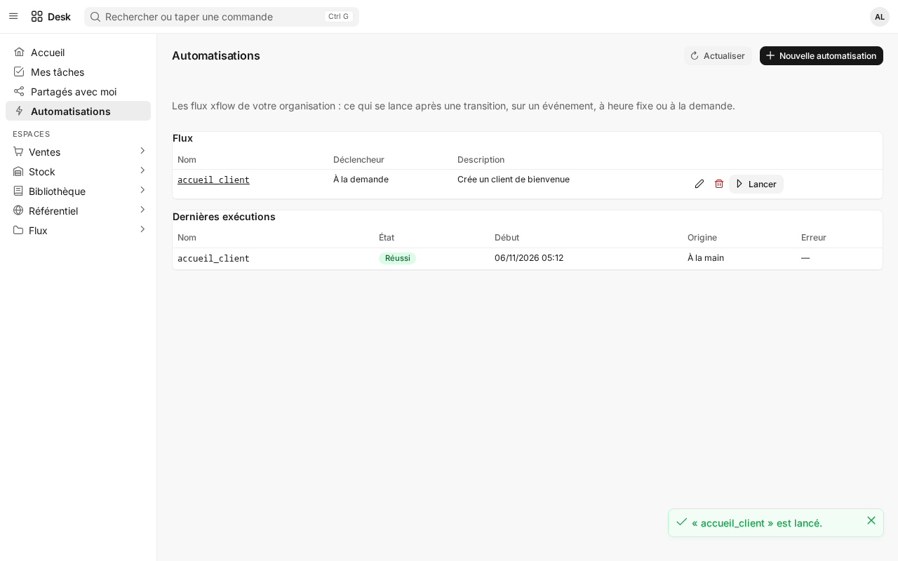
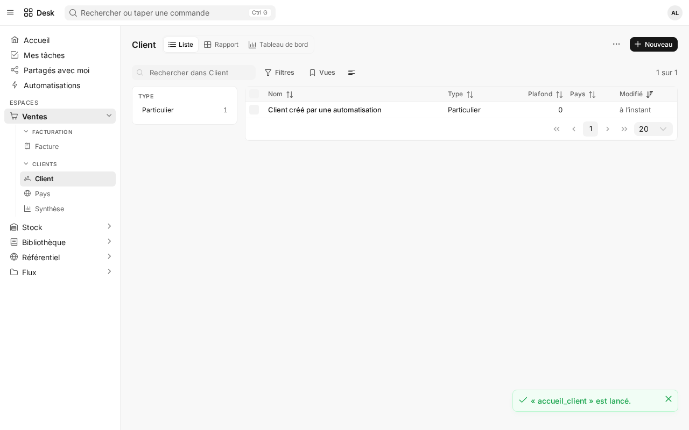
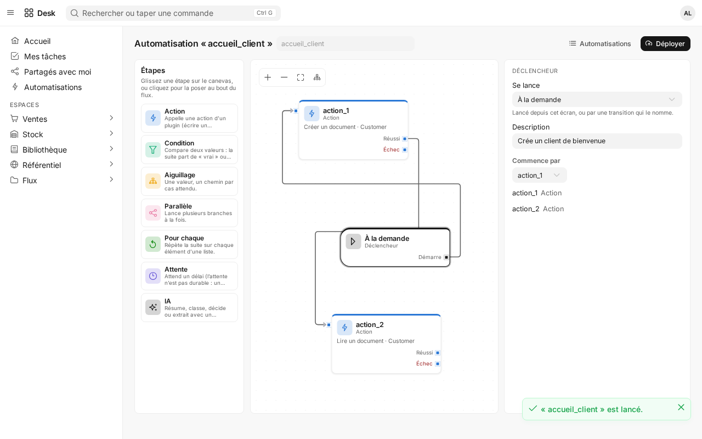

# Guide xcore-doctype : configurer, créer un plugin, utiliser le moteur

Ce guide explique, dans l'ordre où on en a besoin :

1. [Installer et configurer](#1-installer-et-configurer) une instance xcore avec xcore-doctype ;
2. [Créer un plugin métier](#2-créer-un-plugin-métier) (DocTypes, Python, espace, extension du Desk, gabarits d'impression) ;
3. [Utiliser xcore-doctype](#3-utiliser-xcore-doctype) depuis un plugin (services Python, hooks), par l'API HTTP et par le Desk.

Le plugin complet qui sert d'exemple de bout en bout est [`examples/biblio`](../examples/biblio) : des livres et leurs emprunts, en
YAML + Python + JavaScript. Chaque section y renvoie.

---

## 1. Installer et configurer

### 1.1 Ce qu'il faut

- Python **3.14** et une instance **xcore ≥ 2.9** (`xcoreruntime`) ;
- une base **asynchrone** : `sqlite+aio` (développement) ou `postgresql+aio` (production, avec l'extra `[postgres]`) ;
- un plugin d'authentification nommé **`auth`** (xauth) : c'est lui qui délivre les jetons et reçoit les grants.

```bash
pip install xcore-doctype            # le wheel embarque le Desk
pip install "xcore-doctype[pdf]"     # + l'impression PDF (optionnelle)
pip install "xcore-doctype[postgres]" # + asyncpg pour PostgreSQL
```

### 1.2 Poser le plugin dans l'instance

xcore découvre les plugins **par dossier** : `pip install` seul ne charge rien. La commande `install` dépose le plugin et vérifie
l'instance :

```bash
xcore-doctype install ./app          # ./app = plugins.directory de votre integration.yaml
```

Elle écrit :

| Dossier | Contenu | Réécrit à chaque `install` ? |
|---|---|---|
| `app/xcore-doctype/` | le moteur (`plugin.yaml` + un petit `src/main.py`) | le code oui, **`plugin.yaml` non** (c'est votre copie, gardée sauf `--force`) |
| `app/system/` | les réglages de base (`System Settings`), les règles de notification, les restrictions d'utilisateur | oui (un fichier que vous y ajoutez est gardé, avec un avertissement) |
| `app/xlicense/`, `app/xpulse/`, `app/xprint/`, `app/xflow/` | la plateforme : licences/modules, temps réel, gabarits d'impression des pièces ERP, automatisations | le code oui, `plugin.yaml` non |

Puis elle affiche un diagnostic (`xcore-doctype doctor` le refait à tout moment) : base synchrone, `xcore.setup(app)` manquant,
tenancy incohérente, plugin `auth` absent, manifeste qui ferme encore les extensions…

### 1.3 `integration.yaml` (l'hôte xcore)

Les points qui comptent pour xcore-doctype :

```yaml
app:
  plugin_prefix: "/app"          # les routes du moteur seront sous /app/xcore-doctype

tenancy:
  enabled: true
  isolate_db: false              # OBLIGATOIRE : l'isolation est la colonne tenant_id (sinon HTTP et IPC divergent)

plugins:
  directory: ./app
  strict_trusted: false          # true en production : signez alors les plugins (xcli plugin security sign …)

services:
  databases:
    default:
      type: sqlite+aio           # ou postgresql+aio ; « sqlite » seul est l'adaptateur SYNCHRONE : refusé
      url: sqlite+aiosqlite:///./xcore.db
```

### 1.4 `main.py` (le point d'entrée)

```python
from contextlib import asynccontextmanager
from fastapi import FastAPI
from xcore import Xcore

xcore = Xcore(config_path="integration.yaml")

@asynccontextmanager
async def lifespan(app: FastAPI):
    await xcore.boot(app)
    yield
    await xcore.shutdown()

app = FastAPI(lifespan=lifespan)
xcore.setup(app)   # OBLIGATOIRE : installe le TenantMiddleware (sinon 500 tenant_middleware_missing)
```

Lancement : `uvicorn main:app`. Le Desk est alors servi sous `http://hôte/app/xcore-doctype/desk/`.

**Servir le Desk ailleurs** (à la racine d'un domaine, sous `/erp`…) :

```python
from xcore_doctype import Config, mount_desk

mount_desk(app, Config(path="/erp", api_base="/app/xcore-doctype", login_url="/app/auth/login"))
```

Le Desk monté lit la liste des extensions et l'annonce du temps réel chez le plugin : laissez `doctype.desk.enabled` à `true`.

### 1.5 Le manifeste du moteur (`app/xcore-doctype/plugin.yaml`, bloc `doctype:`)

C'est **votre** copie : `install` ne la réécrit pas. Les réglages courants :

```yaml
doctype:
  enforce_tenant_binding: true   # false SEULEMENT si tenancy.enabled est false
  tenant_claim: tenant_id
  timezone: Africa/Abidjan       # fuseau des séries de numérotation ({YYYY}…) et de « aujourd'hui »
  rls: false                     # PostgreSQL : Row Level Security en plus (rôle de connexion ordinaire exigé)
  doctypes_dirs: []              # VOS DocTypes d'opérateur (les plugins apportent les leurs autrement, §2)
  directory:   { provider: xauth }           # annuaire des membres (assignations, mentions) ; none pour s'en passer
  notifications: { provider: xauth, email: true, desk_url: https://erp.example.com/app/xcore-doctype/desk/ }
  desk:
    enabled: true
    login_url: auth              # « auth » = <préfixe>/auth/login ; null = jeton collé (développement)
    # extensions: [sales]        # absent = toutes les extensions déclarées par les plugins ; [] = aucune
    # developer_mode: true       # le constructeur de DocTypes à l'écran (développement seulement)
```

Les actions d'**opérateur** (`ops.history.purge`, `ops.trash.purge`) sont fermées : décommentez leur ligne dans `permissions:` pour les
ouvrir. Elles exigent aussi un jeton qui porte le grant `cross_tenant_grant`.

### 1.6 Réglages de l'organisation (dans le Desk)

**Paramètres › Général** (DocType `System Settings` du plugin `system`, réservé aux administrateurs) : nom, logo, couleur, format de
date, langue, et la section **Impression** — le **fond PDF** (votre papier à en-tête : logo, coordonnées, pied de page, mentions),
les pages où il s'applique et les zones réservées en haut et en bas. Toutes les impressions s'impriment par-dessus.

### 1.7 Développement dans ce dépôt

```bash
make install   # poetry install + pnpm install (ui/)
make dev       # backend :8000 + Vite :5173, rechargement à chaud ; identifiants dans .env
make check     # build du Desk + tous les tests : à lancer avant de rendre un travail
```

---

## 2. Créer un plugin métier

Un plugin métier **apporte ses données** (DocTypes) au moteur ; il n'écrit ni SQL, ni route CRUD, ni écran de formulaire. Arborescence
type (celle de `examples/biblio`) :

```
mon_module/
├── plugin.yaml          # le manifeste xcore
├── src/main.py          # charge le tout, déclare les grants, fournit les hooks
├── doctypes/*.yaml      # les types de documents (OBLIGATOIRE)
├── workspaces/*.yaml    # la page d'accueil du module dans le Desk (facultatif)
├── print/*.yaml         # des gabarits d'impression livrés (facultatif)
├── extends/*.yaml       # des champs ajoutés aux DocTypes d'un AUTRE plugin (facultatif)
├── translations/*.yaml  # les libellés traduits (facultatif)
└── desk/index.js        # une extension JavaScript du Desk (facultatif)
```

> **Règle des noms.** Le nom du plugin est `[a-z0-9_]+` (pas de tiret) et chaque DocType déclare `module: <nom du plugin>` : c'est
> l'espace de noms de ses grants (`biblio:livre:read`). Les workspaces et traductions vivent **à côté** de `doctypes/`, jamais dedans
> (tout fichier de `doctypes/` est lu comme un DocType).

### 2.1 Le manifeste (`plugin.yaml`)

```yaml
name: biblio
version: 0.1.0
framework_version: ">=2.9"
execution_mode: trusted          # un plugin en bac à sable n'a pas accès aux services du moteur
entry_point: src/main.py
requires: [xcore-doctype, auth]  # le moteur fournit les services ; auth reçoit les grants
permissions:                     # sans ce bloc, xcore refuse toute action du plugin
  - { resource: "biblio.*", actions: ["execute"], effect: allow }
```

Citez entre guillemets toute `description:` qui contient « `: ` » : un manifeste YAML invalide est ignoré avec un simple avertissement,
et ses hooks n'existent alors jamais (chaque sauvegarde répond 503).

### 2.2 Un DocType (`doctypes/livre.yaml`)

```yaml
schema_version: 1
name: Livre
label: Livre
module: biblio                   # = le nom du plugin
icon: book                       # un nom PrimeIcons, sans « pi- »
title_field: titre               # ce qu'un lien affiche à la place de l'identifiant
fields:
  - { fieldname: titre,  label: Titre,  fieldtype: Text,   required: true, in_list_view: true }
  - { fieldname: auteur, label: Auteur, fieldtype: Text,   in_list_view: true }
  - { fieldname: genre,  label: Genre,  fieldtype: Select, options: [Roman, Essai, BD], default: Roman }
  - { fieldname: isbn,   label: ISBN,   fieldtype: Text,   unique: true }
layout:
  - { section: Le livre, columns: [[titre, auteur], [genre, isbn]] }
```

**Types de champ** : `Text`, `LongText`, `TextEditor`, `Code`, `Int`, `Number`, `Percent`, `Decimal`, `Currency`, `Rating`, `Date`,
`Datetime`, `Time`, `Duration`, `Boolean`, `Select`, `Link`, `DynamicLink`, `Table`, `Color`, `Image`, `Attach`, `JSON`, `Password`.
Un montant est un `Decimal`/`Currency` (avec `decimals:`), jamais un `Number` : il est exact.

**Ce qu'un DocType sait déclarer**, sans une ligne de Python :

| Besoin | Clé YAML |
|---|---|
| Numérotation sans trou | `naming: { series: "FA-{YYYY}-{#####}" }` (ou `prompt`, `{field: code}`, `hash`) |
| Champ visible/obligatoire/en lecture seule selon une condition | `depends_on`, `mandatory_depends_on`, `read_only_depends_on` (`"statut == 'Rendu'"`) |
| Lien vers un autre type | `fieldtype: Link, options: Client` (+ `link_filters`, `target_status`) |
| Lignes (un tableau dans le document) | `fieldtype: Table, options: Ligne Facture` + un DocType `istable: true` |
| Valeur copiée d'un document lié | `fetch_from: client.adresse` |
| Calcul | `compute: "qty * rate"`, `"total + taxes - remise"`, `"sum(items.amount)"` |
| Document validé puis figé | `submittable: true` (brouillon → soumis → annulé, `amend`) |
| Circuit d'approbation | `workflow: { states, transitions }` |
| Onglets dans le formulaire | `tab:` sur les sections du `layout` |
| Vues | `views: { kanban, calendar, gantt, dashboard }` |
| Droits autres que la convention | `permissions: { read: [...], write: [...], create: [...], delete: [...] }` |

**Droits par convention** (sans bloc `permissions`) : `<module>:<doctype>:read`, `…:write` (créer et modifier), `…:delete`, et pour un
type soumettable `…:submit` / `…:cancel`. Le nom du type est mis en minuscules, les espaces deviennent `_` (`Stock Entry` →
`stock:stock_entry:read`).

### 2.3 Le Python (`src/main.py`)

```python
from pathlib import Path
from xcore.sdk import AutoDispatchMixin, TrustedBase
from xcore_doctype import DocumentValidationError, HookEvent

ROOT = Path(__file__).resolve().parent.parent

class Plugin(AutoDispatchMixin, TrustedBase):
    async def on_load(self) -> None:
        # 1. Les hooks D'ABORD : un type dont un hook manque refuse ses sauvegardes (503).
        hooks = self.get_service("doctype_hooks")
        hooks.register("biblio.verifie_dates", self.verifie_dates, owner=self.ctx.name)

        # 2. Les définitions, dans cet ordre.
        registry = self.get_service("doctype_registry")
        registry.load_dir(self.ctx.name, ROOT / "doctypes")              # tout ou rien
        registry.load_extensions(self.ctx.name, ROOT / "extends")         # si le dossier existe
        registry.load_workspaces(self.ctx.name, ROOT / "workspaces")
        registry.load_print_templates(self.ctx.name, ROOT / "print")
        registry.load_translations(self.ctx.name, ROOT / "translations")
        registry.load_desk(self.ctx.name, ROOT / "desk")

        # 3. UN seul rbac.declare, tiré du YAML : rien n'est retapé à la main.
        grants = self.get_service("doctype_grants").for_plugin(self.ctx.name)
        await self.ctx.events.emit("rbac.declare", {"plugin": self.ctx.name, "grants": grants}, source=self.ctx.name)

    async def on_unload(self) -> None:
        self.get_service("doctype_hooks").unregister_owner(self.ctx.name)
        self.get_service("doctype_registry").unregister_owner(self.ctx.name)

    async def verifie_dates(self, event: HookEvent) -> None:
        if event.data.get("rendu_le") and event.data["rendu_le"] < event.data.get("sortie", ""):
            raise DocumentValidationError("Retour avant la sortie",
                details=[{"field": "rendu_le", "msg": "Ne peut pas précéder la sortie", "type": "hook_rejected"}])
```

Ne chargez que les dossiers qui existent (un plugin YAML seul n'a que `load_dir` + `rbac.declare`). Le DocType cite ses hooks **par
nom** :

```yaml
hooks:
  validate: [biblio.verifie_dates]
  before_save: [biblio.duree]
```

### 2.4 La page du module (`workspaces/biblio.yaml`)

```yaml
schema_version: 1
name: biblio                     # = le plugin
label: Bibliothèque
icon: book
order: 30
blocks:
  - { type: number_card, label: Emprunts en cours, doctype: Emprunt, filters: { statut: En cours } }
  - { type: chart, label: Emprunts par mois, doctype: Emprunt, kind: bar, group_by: sortie, bucket: month, periods: 6 }
  - { type: shortcut, doctype: Emprunt, new: true }
```

Blocs : `header`, `paragraph`, `spacer`, `shortcut`, `number_card`, `chart`, `quick_list`, `card`, `extension`. Chaque utilisateur ne
voit que ce qu'il a le droit de lire. Un fichier avec `contributes_to: <autre module>` à la place de `name` ajoute des blocs à
l'espace d'un autre plugin.

### 2.5 Un gabarit d'impression (`print/standard.yaml`)

```yaml
schema_version: 1
doctype: Facture
name: standard
label: Facture
page: { size: A4, orientation: portrait, top: 20, bottom: 20, left: 15, right: 15 }
blocks:
  - { type: title, text: "Facture {{ name }}" }
  - { type: fields, columns: 2, fields: [client, date, echeance] }
  - type: table
    field: lignes
    style: accent                # bordered | ruled | plain | striped | accent | boxed
    columns:
      - { field: article, width: 50 }
      - { field: qte, align: right, width: 15 }
      - { field: montant, align: right, width: 35 }
  - { type: totals, fields: [total_ht, tva, total_ttc] }
```

Exemples complets, en document libre (`content`, libellés en français) : le plugin
[`xprint`](../src/xcore_doctype/platform/xprint) livre devis, commande, facture, bon de livraison, commande fournisseur et reçu de
paiement pour les DocTypes ERP de `doctypes/`.

Blocs : `title`, `fields`, `table`, `totals`, `text`, `spacer`, `page_break`. Aucun code : `{{ name }}`, `{{ doctype }}` et
`{{ doc.<champ> }}` seulement. Sans gabarit, le moteur en fabrique un depuis le `layout` : aucun document n'est inimprimable. Chaque
organisation peut ensuite le refaire à l'écran (« Personnaliser l'impression ») ; le fond PDF vient de ses Paramètres.

### 2.6 Une extension du Desk (`desk/index.js`)

```bash
xcore-doctype new-desk-extension ./app/biblio   # pose desk/index.js + README, prêt à charger
```

```js
import { defineComponent, h } from 'vue'
import { defineExtension, useDesk } from '@xcore-doctype/desk'

export default defineExtension({
  name: 'biblio',              // = le nom du plugin
  apiVersion: 1,
  setup(desk) {
    desk.routes.add({ path: 'retards', title: 'Retards', component: Retards })   // #/x/biblio/retards
    desk.form.panel({ doctype: 'Livre', title: 'Emprunts', component: LivreEmprunts })
    desk.form.action({ doctype: 'Livre', label: 'Prêter', run: ({ record, router }) => router.push(/* … */) })
  },
})
```

Un module ES écrit à la main (aucun build) : `vue` et `@xcore-doctype/desk` sont fournis par le Desk. Tout passe par l'API avec la
session de l'utilisateur : ses droits s'appliquent. L'extension est servie dès que le plugin l'a déclarée par `load_desk` (sauf si
l'opérateur restreint la liste). Une extension qui plante affiche une notification et n'arrête jamais le Desk.

### 2.7 Vérifier avant de livrer

```bash
xcore-doctype check ./mon_module/doctypes --owner mon_module                 # DocTypes + espaces + extensions + desk/
xcore-doctype check ./sales/doctypes --owner sales --with ./stock/doctypes    # avec les types des plugins qu'il `requires`
```

Puis : lien symbolique dans `app/` (`ln -s ../mon_module app/mon_module`), relance, et attribuez les grants `mon_module:*` à un rôle
(Paramètres › Système › Rôles). L'organisation qui crée son espace les reçoit d'office.

---

## 3. Utiliser xcore-doctype

### 3.1 Depuis un plugin : les services

| Service | À quoi il sert |
|---|---|
| `doctype_registry` | charger ses définitions (`load_dir`, `load_workspaces`, `load_print_templates`, `load_extensions`, `load_translations`, `load_desk`) et les retirer (`unregister_owner`) |
| `doctype_hooks` | enregistrer ses hooks par nom (`register(nom, coroutine, owner=…)`) |
| `doctype_grants` | la liste des grants de ses DocTypes, prête pour `rbac.declare` (`for_plugin(nom)`) |
| `doctype_writer` | **écrire** : `await writer.as_request(request)` dans une route du plugin (droits de l'utilisateur), `writer.system(plugin, tenant, raison)` pour une tâche planifiée (seulement les types du plugin) |
| `doctype_documents` | **lire** en contexte système, nommé par sa raison : `system(tenant, raison).list(…) / .get(…)` |
| `doctype_sources` | brancher une source externe pour un DocType virtuel (`source: <nom>`) |
| `doctype_channels` | déclarer un **canal de notification** (WhatsApp, SMS…) : `register(plugin, nom, coroutine, listen_all=…)`, voir §3.6 |

Méthodes du *writer* : `get`, `list`, `create`, `update`, `submit`, `cancel`, `amend`, `transition`, `delete`, et `ensure(doctype,
data, unique=<champ>)` pour une tâche rejouable (crée ou retrouve, sans doublon même en concurrence).

```python
@router.post("/reception-rapide")
async def reception(request: Request, body: dict):
    docs = await self.get_service("doctype_writer").as_request(request)   # 401/403 comme l'API
    entry = await docs.create("Stock Entry", {"purpose": "Réception", "items": body["items"]})
    return await docs.submit("Stock Entry", entry["name"], version=entry["version"])
```

### 3.2 Les hooks

| Moment | Ce que le hook peut faire |
|---|---|
| `validate` | refuser (`raise DocumentValidationError`, 422) ; `data` en lecture seule |
| `before_save` / `before_insert` | modifier `event.data` en place (revalidé ensuite) |
| `after_save` / `after_insert` / `after_delete` | réagir après le commit (une erreur est journalisée, rien n'est défait) |
| `on_submit` / `before_cancel` / `on_cancel` / `on_update_after_submit` / `on_trash` | écrire **d'autres** documents dans la MÊME transaction par `event.tx` |

`event.tx` : `get(doctype, nom, lock=True)`, `create`, `ensure`, `update`, `find(doctype, filtres, …)`, `sum(doctype, champ,
filtres)` (exact), `today`. Un refus annule tout, état du document compris. Un hook qui lit puis écrit **verrouille** (`lock=True`).

`HookEvent` porte `event`, `ctx`, `doctype`, `name` (`None` pendant la création d'un type numéroté), `data`, `old`.

### 3.3 Par l'API HTTP

Toutes les routes sont sous `<plugin_prefix>/xcore-doctype` et exigent `Authorization: Bearer <jeton>` et `X-Tenant-ID: <organisation>`.

| Route | Rôle |
|---|---|
| `GET /meta`, `GET /meta/{doctype}` | les types visibles, et la définition d'un type (champs, droits effectifs, vues) |
| `GET /list/{doctype}?filters=…&order_by=…&order=asc&limit=…&offset=…` | une page de documents |
| `GET /doc/{doctype}/{nom}` | un document |
| `POST /doc/{doctype}` `{data}` | créer |
| `PUT /doc/{doctype}/{nom}` `{data, version}` | modifier (verrou optimiste : `version` obligatoire) |
| `DELETE /doc/{doctype}/{nom}` | supprimer (vers la corbeille) |
| `POST /doc/{doctype}/{nom}/submit\|cancel` `{version}`, `…/amend`, `…/transition` `{action, version}` | cycle de vie |
| `GET /search/{doctype}?q=…` | autocomplétion |
| `GET /aggregate/{doctype}` | compter, sommer, regrouper |
| `GET /history/{doctype}/{nom}` | historique des modifications |
| `POST /bulk/{doctype}`, `POST /import/{doctype}` | actions en lot, import CSV |
| `GET /print/{doctype}/{nom}`, `…/pdf` | aperçu HTML, PDF |

Filtres : un objet JSON, `{"statut": "En cours"}` pour l'égalité, `{"date": [">=", "2026-01-01"]}` sinon (`=`, `!=`, `<`, `>`, `<=`,
`>=`, `like`, `in` selon le type du champ : pas d'ordre sur un texte, `like` insensible à la casse, `in` jusqu'à 100 valeurs). Les erreurs ont la forme `{"detail": {"code": "…", "msg": "…", "details": [...]}}` ;
un document hors de vos droits répond 404, comme s'il n'existait pas. Chaque route a sa jumelle en action IPC (`doc.save`, `doc.list`,
`doc.print`…).

### 3.4 Par le Desk

L'interface est générée depuis les définitions : listes (et vues kanban, calendrier, gantt, rapport, tableau de bord), formulaires
avec onglets et tables de lignes, recherche `Ctrl+K`, commentaires, assignations, pièces jointes, étiquettes, partages, corbeille,
historique, import CSV, impression. Pour chaque type, le menu « ⋯ » donne aussi accès à la personnalisation de l'organisation :

- **Personnaliser le formulaire** : disposition, libellés, champs ajoutés (`custom_…`), règles (obligatoire, lecture seule, défaut) ;
- **Personnaliser l'impression** : un éditeur façon traitement de texte, avec les styles de tableau et un fond PDF propre au gabarit ;
- **Circuit** : resserrer les transitions d'un workflow ;
- et sur chaque espace, **Personnaliser** ses blocs, pour l'organisation ou pour soi.

Rien de tout cela n'écrit de fichier : une personnalisation vit en base, par organisation ; une définition vit dans un plugin.

### 3.5 Appeler son plugin depuis le Desk

**Le navigateur n'appelle jamais une action IPC.** Le routeur IPC d'xcore exige la clé serveur `X-Plugin-Key` (`app.secret_key`), qui
ne doit pas quitter le serveur. Le chemin est toujours le même : le plugin expose une **route HTTP**, l'extension du Desk l'appelle, et
c'est la route (côté serveur) qui écrit des documents ou appelle des actions IPC d'autres plugins.

Côté plugin, la route (montée par xcore sous `<plugin_prefix>/<plugin>/…`) :

```python
from fastapi import APIRouter, HTTPException, Request

class Plugin(AutoDispatchMixin, TrustedBase):
    async def on_load(self) -> None:
        ...
        self._router = self._routes()

    def get_router(self) -> APIRouter | None:
        return self._router

    def _routes(self) -> APIRouter:
        router, writers = APIRouter(), self.get_service("doctype_writer")

        @router.post("/envoyer/{name}")
        async def envoyer(name: str, request: Request) -> dict:
            docs = await writers.as_request(request)        # l'utilisateur de la requête : 401 sans jeton, ses grants s'appliquent
            facture = await docs.get("Sales Invoice", name) # 404 s'il ne peut pas la lire, comme l'API
            ctx = docs.context                              # ctx.user_id, ctx.tenant_id : jamais lus dans le corps de la requête
            result = await self.call_plugin("xpulse", "xpulse.publish", {   # l'IPC, CÔTÉ SERVEUR
                "user_id": ctx.user_id, "text": f"Facture {name} envoyée", "event_type": "whatsapp.sent", "data": {"name": name},
            })
            if result.get("status") == "error":
                raise HTTPException(502, {"code": "send_failed", "msg": "Envoi refusé"})
            return {"ok": True, "total": facture["data"].get("grand_total")}

        return router
```

Côté Desk, l'extension (`desk/index.js`) :

```js
setup(desk) {
  desk.form.action({
    doctype: 'Sales Invoice', label: 'Envoyer par WhatsApp', icon: 'send',
    when: ({ record }) => record?.docstatus === 1,          // ne protège rien : la route juge chaque appel
    run: async ({ name, plugin, notify }) => {
      await plugin.post(`/envoyer/${encodeURIComponent(name)}`)   // -> <prefix>/<votre plugin>/envoyer/…
      notify.success('Envoyée')
    },
  })
}
```

`plugin.get/post/put/patch/delete` (dans une action, une commande, ou `useDesk().plugin` dans un composant) n'atteint QUE les routes de
**son** plugin, avec la session du Desk : jeton, organisation (`X-Tenant-ID`), renouvellement sur un 401. Un chemin qui tenterait d'en
sortir (`..`, `//`, une URL complète) est refusé avant tout envoi. Pour lire ou écrire des documents depuis l'extension, `api` (le
client du moteur) suffit ; une route n'est utile que pour ce que l'API ne fait pas (un service externe, une action IPC, un calcul).

### 3.6 Les canaux de notification : WhatsApp, SMS, Slack…

Le moteur prévient les gens par la cloche (xauth) et l'e-mail. Un plugin y ajoute **son** canal par le service `doctype_channels` :

```python
class Plugin(AutoDispatchMixin, TrustedBase):
    async def on_load(self) -> None:
        self.get_service("doctype_channels").register(self.ctx.name, "whatsapp", self.envoyer, label="WhatsApp", listen_all=True)

    async def on_unload(self) -> None:
        self.get_service("doctype_channels").unregister_owner(self.ctx.name)

    async def envoyer(self, n) -> None:                    # n : xcore_doctype.channels.Notification
        if n.kind not in ("ASSIGNMENT", "RULE"):           # VOTRE filtre : le moteur passe tout, le plugin choisit
            return
        for user_id in n.user_ids:
            numero = await self.numero_de(n.tenant_id, user_id)   # à vous : un DocType « Contact WhatsApp », un champ du profil…
            if numero:
                await self.api_whatsapp.send(numero, f"{n.title}\n{n.message or ''}")
```

Ce que reçoit `envoyer` (une `Notification`, gelée) : `tenant_id`, `user_ids`, `title`, `message`, `link` (`#/app/<type>/<nom>`),
`kind` (`RULE`, `ASSIGNMENT`, `MENTION`, `SHARE`), `emails` (les adresses que l'annuaire connaît), `doctype` et `name` (le document
concerné, s'il y en a un), `rule` (le nom de la règle). **Jamais le contenu du document** : s'il vous le faut, relisez-le par
`doctype_documents.system(n.tenant_id, "whatsapp").get(n.doctype, n.name)`.

Deux façons de recevoir :

- **`listen_all=True`** : tout ce qui fait sonner la cloche (assignations, @mentions, partages, règles au canal « Cloche »), juste après elle ;
- **une règle qui nomme le canal** : dans Paramètres › Général › Règles de notification, le champ « Canal d'un plugin » (`whatsapp`) ;
  le canal « Canal du plugin seul » n'envoie QUE là (ni cloche, ni e-mail). Un nom qu'aucun plugin chargé ne fournit est refusé à
  l'enregistrement de la règle, avec la liste de ceux qui existent ; un plugin déchargé depuis est journalisé, la cloche part quand même.
  Un canal qui écoute tout ET que la règle nomme la reçoit une seule fois.

Un envoi part en tâche de fond, borné à 15 s : une API WhatsApp lente, en panne ou une exception de votre code sont **journalisées**,
jamais remontées, et n'annulent jamais l'écriture qui a causé la notification. Le nom d'un canal : `[a-z][a-z0-9_]`, 32 caractères au
plus, propriété du plugin qui l'a déclaré.

### 3.7 Le temps réel : publier, écouter

Le Desk ouvre un seul flux SSE vers xpulse (`<prefix>/xpulse/stream`) sur deux canaux : `notification` (à l'utilisateur seul) et
`tenant-<organisation>` (tous ses membres). Le moteur y publie déjà `doc.changed` (les listes et fiches se relisent seules) et
`bell.changed` (la cloche). Un plugin y publie **ses** messages par IPC, avec un type et des données :

```python
await self.call_plugin("xpulse", "xpulse.publish", {         # à UN membre (canal personnel)
    "user_id": user_id, "text": "Nouveau message de Koné", "event_type": "whatsapp.received", "data": {"from": "+225…"},
})
await self.call_plugin("xpulse", "xpulse.broadcast", {       # à toute l'organisation
    "channels": [f"tenant-{tenant_id}"], "text": "Inventaire ce soir", "event_type": "stock.notice",
})
```

L'appel exige que le manifeste d'xpulse autorise le module (`allowed_callers: ["*"]`, livré depuis le 5 nov.) ; un xpulse installé
avant garde son manifeste et répond `ipc_denied` : `xcore-doctype install` le signale, ajoutez la ligne à votre copie.

`event_type` : `[a-z0-9_.:-]`, 64 caractères, préfixé du nom du plugin par convention (`doc.changed` et `bell.changed` sont refusés :
ils appartiennent au moteur). `data` : un objet JSON de 8 Ko au plus, sans les clés d'enveloppe (`user_id`, `tenant_id`, `event_type`,
`text`, `channel`). Le texte est échappé par xpulse ; `data` ne l'est pas : affichez-le comme du TEXTE (Vue le fait), jamais en HTML.
Un message à l'organisation est vu par TOUS ses membres : n'y mettez rien qu'un membre sans droit ne doive voir.

L'extension écoute par `desk.realtime` :

```js
setup(desk) {
  desk.realtime.on('whatsapp.received', (m) => desk.notify.info(m.text))   // m : { scope, type, text, data }
}
```

Ce que `setup` écoute est retiré avec l'extension. Dans un composant, `useDesk().realtime.on(...)` renvoie de quoi se désabonner, à
appeler dans `onUnmounted`. `'*'` reçoit tous les types. Sans xpulse (`desk.realtime.available === false`), rien n'arrive et rien
n'échoue. Le canal `ext.websocket` existe aussi côté serveur, mais le Desk ne l'utilise pas : SSE suffit pour pousser vers le navigateur.

### 3.8 Le workflow et ses automatisations (xflow)

Deux moteurs, chacun son métier :

- **le workflow du moteur** garde l'ÉTAT du document : états, qui a le droit de transiter (un grant par transition), `not_owner`,
  conditions, gel au `docstatus`, boutons de la fiche. Il vit dans le YAML du DocType et dans la même transaction que le document ;
- **xflow** (plugin de plateforme, posé par `install`) orchestre ce qui SUIT : appeler des actions d'autres plugins, conditions,
  boucles, réessais, cron, webhooks, journal de chaque exécution.

Une transition nomme le flux qui la suit :

```yaml
workflow:
  states: [{name: Brouillon}, {name: Approuvée, docstatus: submitted}]
  transitions:
    - {action: Approuver, from: Brouillon, to: Approuvée, not_owner: true, flow: commande_fournisseur}
```

Après le COMMIT de l'approbation, le moteur demande à xflow `trigger` (action IPC) de lancer `commande_fournisseur` dans
l'organisation, **au nom de qui a approuvé** : xflow ne garde que son identifiant et redemande ses droits à xauth
(`xauth.user.permissions`) quand le flux tourne. Le flux reçoit `trigger.doctype`, `trigger.name`, `trigger.version`,
`trigger.action`, `trigger.from`, `trigger.to`, `trigger.user` — jamais le contenu : une étape qui en a besoin le relit par `doc.get`.
Un flux absent, en panne ou refusé est journalisé (`flow not started`, `flow refused`) ; **l'approbation reste faite**. Seul le NOM du
flux se vérifie au chargement : un flux se déploie par organisation chez xflow.

**Le plus simple : « Automatisations » dans la barre latérale, puis « Nouvelle automatisation »** (droit
`xflow:workflows:write`). L'éditeur prend toute la page : la **palette** des étapes à gauche, le **flux en graphe** au milieu, les
**propriétés** de ce qu'on a choisi à droite. On glisse une étape de la palette sur le canevas (ou on clique pour la poser au bout du
flux) et on tire une **poignée** d'un nœud vers un autre pour les enchaîner ; au clavier, les listes « Va vers » du panneau font la
même chose.

**Rien ne se tape : tout se choisit.** Une étape « Action » demande d'abord *que faire* — créer un document, le modifier, le
soumettre, l'annuler, faire avancer son circuit, le supprimer, assigner une tâche, ajouter un commentaire, relire un document — puis
seulement ce que ce geste demande : quel type de document, lequel, et les valeurs à écrire, champ par champ, prises dans la
définition du type. Chaque valeur est **une liste, pas une formule** : une valeur fixe, une information du document déclencheur
(« Son numéro », « Qui a agi », « Nouvel état »…) ou le document d'une étape précédente — et l'un de ses champs. Le déclencheur se
dit de la même façon : « quand une *Facture* est *soumise* », ou « tous les *lundis* à *9 h* ». Il n'y a ni JSON, ni `{{ … }}`, ni
expression cron à écrire.

Le flux garde tout ce que l'éditeur ne montre pas (un `retry`, des webhooks sortants, une étape venue d'un autre plugin) et le place
du graphe voyage avec lui : un collègue qui le rouvre voit le même dessin. Un nœud dit ce qui lui manque encore (« Incomplète ») et
s'il n'est jamais atteint, avant même de déployer. « Déployer » redéploie sous le même nom (le nom ne change plus après le premier
déploiement), « Supprimer » retire le flux et arrête son cron. Le refus d'xflow reste affiché dans la page, sans rien perdre du tracé.

Pas à pas (captures du scénario Chromium `ui/e2e/automations.e2e.mjs`, face au vrai xflow) :

1. **Automatisations** (barre latérale), « Nouvelle automatisation ».
   
2. L'éditeur : palette, canevas et propriétés. Seul le déclencheur est là.
   
3. Une étape glissée de la palette se pose sous le curseur et se relie au déclencheur. Le panneau demande *que faire* (« Créer un
   document »), sur quel type (« Client ») et quelles valeurs écrire : les champs du type se proposent, leurs valeurs se choisissent.
   
4. Une deuxième étape, reliée à la première en tirant sa poignée « Réussi » ; sa cible est « le document de l'étape action_1 ».
   
5. « Déployer » : le flux est listé, avec Modifier, Supprimer et — pour un flux à la demande — « Lancer ».
   
6. « Lancer » : l'exécution apparaît, « Réussi » ou « Échoué » avec son erreur.
   
7. Le document que l'étape a écrit existe, au nom de qui a lancé le flux.
   
8. Rouvrir le flux : le graphe revient tel qu'il a été tracé, et le panneau s'ouvre sur le déclencheur.
   

Le même flux se déploie aussi par l'API d'xflow :

```bash
curl -X POST "$BASE/app/xflow/flows" -H "Authorization: Bearer $TOKEN" -H "Content-Type: application/json" -d '{
  "name": "commande_fournisseur",
  "trigger": {"type": "manual"},
  "steps": [{
    "id": "creer", "type": "action", "plugin": "xcore-doctype", "action": "doc.save",
    "payload": {"doctype": "Purchase Order", "data": {"demande": "{{ trigger.name }}"}}
  }]
}'
```

L'étape `doc.save` écrit avec les droits de l'approbateur : sans `achats:purchase_order:write`, elle échoue (et l'exécution le dit),
elle ne contourne rien. Les autres déclencheurs d'xflow restent disponibles : un **événement** du bus
(`{"type": "event", "event_name": "doctype.Sales Invoice.after_submit"}`) ou une **planification**
(`{"type": "schedule", "cron": "0 9 * * 1-5"}`), qui s'exécutent au nom de qui a DÉPLOYÉ le flux.

Dans le Desk : l'éditeur de circuit (« ⋯ › Circuit d'approbation ») marque d'un éclair une transition qui lance un flux, et
**Automatisations** (barre latérale) liste les flux de l'organisation avec leurs dernières exécutions (état, origine, erreur), lance un
flux « à la demande », en supprime un, et ouvre l'éditeur pleine page pour en tracer un. Réglage : `doctype.flows: false` dans le manifeste du moteur coupe les lancements ; `{plugin, action}` les envoie
ailleurs.

**Ce qu'il faut côté xauth** : l'action IPC `xauth.user.permissions` (les grants d'un membre), avec `xflow` dans ses
`allowed_callers`. **Limites connues** : l'étape `wait` d'xflow attend en mémoire (un redémarrage l'interrompt) et `wait_for_event` n'est pas implémenté ; la liste des exécutions renvoie le résultat de chaque étape à qui a
`xflow:runs:read` (l'écran ne l'affiche pas).


### 3.9 Ajouter ses propres nœuds et déclencheurs à l'éditeur d'automatisations

Un plugin peut offrir à l'éditeur **ses** actions IPC (« Envoyer un e-mail ») et **ses** événements (« E-mail reçu »). Dans l'éditeur,
ce sont des nœuds comme ceux de base : ils sont rangés dans la palette, sous « Des applications », et ils se règlent par un formulaire. Ils
s'enchaînent avec les autres. Chaque plugin le déclare dans une section `xflow:` de son `plugin.yaml` :

```yaml
name: mailer
allowed_callers: [xflow]          # OBLIGATOIRE : c'est xflow qui appellera l'action, au nom de l'utilisateur du flux
permissions:
  - {resource: "mail.send", actions: ["execute"], effect: allow}
xflow:
  nodes:
    - action: mail.send           # une action @action("mail.send") de CE plugin
      label: Envoyer un e-mail
      icon: envelope              # nom PrimeIcons nu
      fields:                     # la charge utile, champ par champ (text, longtext, email, number, boolean, select, date)
        - {name: to, label: Destinataire, type: email, required: true}
        - {name: subject, label: Objet, type: text, required: true}
        - {name: body, label: Message, type: longtext}
      outputs:                    # ce que son résultat contient, qu'une étape SUIVANTE peut reprendre
        - {path: message_id, label: Identifiant du message}
  events:
    - name: mailer.received       # préfixé du nom du plugin
      label: E-mail reçu
      fields:                     # les clés de sa charge, que les étapes reprennent
        - {name: sender, label: Expéditeur}
        - {name: subject, label: Objet}
```

Le moteur ne lit pas les manifestes des autres plugins. Le plugin passe donc sa section dans son `on_load` et la retire dans son
`on_unload` :

```python
async def on_load(self) -> None:
    self.get_service("doctype_registry").declare_xflow(self.ctx.name, self.ctx.config.get("xflow"))

async def on_unload(self) -> None:
    self.get_service("doctype_registry").unregister_owner(self.ctx.name)   # retire aussi ses nœuds
```

Une section fautive fait échouer le chargement du plugin, comme un DocType fautif : un champ inconnu, un `select` sans options, ou
un événement qui ne commence pas par `<plugin>.`. Le Desk la lit sur `GET /flow-catalog` (action IPC `meta.flow_catalog`).

**Enchaîner, et déclencher depuis un autre plugin.** Les deux sources se combinent dans un même flux. Par exemple :

1. le déclencheur est l'événement `mailer.received` du plugin *mailer* ;
2. une étape « Créer un document » crée la fiche *Client*, avec comme nom « Du déclencheur › Objet » ;
3. une étape « Envoyer un e-mail » répond à « Du déclencheur › Expéditeur ». Son message cite le document de l'étape 2, et une étape
   suivante pourrait reprendre « Résultat d'une étape › Identifiant du message » de celle-ci.

Rien ne se tape, tout se choisit dans des listes. L'éditeur écrit lui-même `{{ trigger.sender }}`,
`{{ steps.creer.result.doc.name }}` ou `{{ steps.envoyer.result.message_id }}`, et xflow résout ces jetons à l'exécution.

Ce qu'il faut savoir :

- **L'événement doit porter `tenant_id` dans sa charge.** Le plugin l'émet après une action d'un utilisateur, avec le tenant de la
  requête :

  ```python
  await self.ctx.events.emit("mailer.received", {"tenant_id": ctx.tenant_id, "sender": ..., "subject": ...})
  ```

  Sans `tenant_id`, xflow lance le flux de **toutes** les organisations qui écoutent cet événement.
- **Qui agit.** Un flux déclenché par un événement agit au nom de qui l'a déployé. Un flux lancé par une transition agit au nom de
  l'approbateur.
- **Les droits.** La section ne fait que décrire le nœud à l'écran : elle n'accorde aucun droit. L'action garde ses propres contrôles.
- **Un appel non déclaré.** Un nœud qu'aucun plugin chargé ne déclare reste visible et s'exécute toujours, mais il ne se règle pas dans
  l'éditeur.
- **Les champs obligatoires.** Un champ `required` laissé vide marque la carte « Incomplète », et le déploiement est refusé.

Preuve sur un vrai hôte : `tests/integration/test_xflow_plugin_nodes.py`, avec le plugin de test `tests/support/plugins/mailer`. Un
e-mail reçu crée un client, puis le plugin répond avec le numéro de ce client, au nom de qui a déployé le flux.

---

## Pour aller plus loin

| Sujet | Document |
|---|---|
| Le contrat de conception (décisions D1-D29) | [`process/doctype.md`](../process/doctype.md) |
| Extensions entre plugins et du Desk | [`process/extensions.md`](../process/extensions.md) |
| Impression et PDF | [`process/impression.md`](../process/impression.md) |
| L'authentification (xauth) | [`process/xauth.md`](../process/xauth.md) |
| Le plugin d'exemple, pas à pas | [`examples/biblio/README.md`](../examples/biblio/README.md) |
